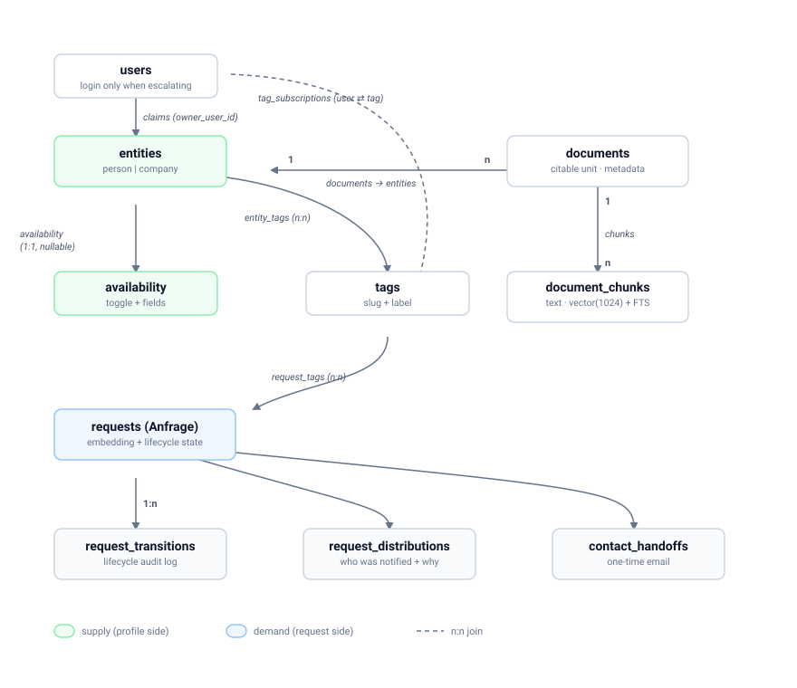

# Orbit — Data Model & API Contract (v2)

> **Status:** AP3 / AP8 deliverable. The schema you code the Spring backend against.
> **Supersedes:** the prototype `v10_*` schema in `prototyping/industryProfiles/10_schema.sql`.
> **Aligns to:** SystemDesign architecture (React SPA → API gateway → Spring Boot modulith → PostgreSQL/pgvector + Ollama e5-large + Gemini Flash rationale).
> **Companion:** `01_user_stories_moscow.md` (every story below is tagged with the tables/endpoints it needs).

## 0. What changed from the prototype (v10 → v2) and why

The Node prototype proved the hard part — hybrid retrieval, entity/document split, cited rationale — against a schema that still encoded the **old** concept. The Orbit concept the team sent Norbert changed three load-bearing things. This is the migration:

| Prototype (`v10_*`) | Orbit v2 | Reason |
|---|---|---|
| `inserate.kind = suche \| biete \| open_call` | **`requests`** table; no `biete`. Supply is a profile, never a post. | Spec killed active "Bieten". The board is demand-only (US-OFFER-1, Won't). |
| Inserat had `status = active \| expired \| closed` | **Explicit 4-state lifecycle** `OPEN → DISTRIBUTED → CONTACTED → CLOSED` with a transitions table | The lifecycle is now a core, visible MVP feature (US-REQ-2). |
| No availability concept | **`availability`** sub-record on entity (toggle + structured fields) | "Offen für Anfragen" toggle is core supply gesture (US-PROF-3). |
| No presence concept | **`presence_mode`** field on requests *and* entities | Presence (Vor Ort / Hybrid / Remote) re-weights proximity differently from scope (Norbert feedback). |
| `entities` mixes person/company | Kept unified (`type`), plus `verified` flag for HR-Verifikation | Org onboarding via Zefix earns a badge (US-ONB-2). |

The entity ↔ document split and inserate/requests carrying their own embedding are **kept** — they were the right calls and are validated by the prototype. **Changed:** `scope` is now a **hard filter** applied before ranking (out-of-scope rows are excluded from the candidate set), not a re-rank weight. This replaces the earlier "scope only re-weights" design (→ US-SRCH-2).

**Document chunking (added in AP8 design).** The document embedding is moved off the `documents` row into a new **`document_chunks`** child table (text + `vector(1024)` + FTS per chunk). A document is the citable unit; a chunk is the retrieval unit. This makes `documents` a proper Spring Data JDBC aggregate root with `document_chunks` as its `@MappedCollection` child, so re-embedding one large document never rewrites others. Requests stay embedded **whole** (no chunking) — request text is short. *Migration:* a new Flyway script (`V4__document_chunks.sql`) creates `document_chunks`, moves `embedding`/`tsv` off `documents`, and backfills one chunk per existing document. See `02.1-aggregation-logic.md` §3.2 / §6.

The `v10_` prefix is dropped; this is the production schema.

---

## 1. Entity-relationship overview



<details><summary>ASCII version</summary>

```
                    ┌──────────────┐
                    │    users     │  authenticated account (login only when escalating to a request)
                    └──────┬───────┘
                           │ claims (owner_user_id)
                    ┌──────▼───────┐    1   n ┌───────────────┐   1   n ┌──────────────────┐
                    │   entities   │◄────────│  documents    │────────▶│ document_chunks  │
                    │ person|company│         │ (citable unit)│         │ (text+vector+FTS)│
                    └──┬───────┬───┘         └───────────────┘         └──────────────────┘
        availability   │       │  entity_tags (n:n tags)
        (1:1, nullable)│       │
              ┌────────▼──┐    │            ┌───────────────┐
              │availability│   └────────────│     tags      │
              └───────────┘                 └───────┬───────┘
                                                    │ request_tags (n:n)
                    ┌──────────────┐                │            tag_subscriptions (user ⇄ tag)
                    │   requests   │────────────────┘
                    │ (the Anfrage)│  embedding + FTS, demand-side, lifecycle state
                    └──────┬───────┘
                           │ 1:n
              ┌────────────▼─────────┐   ┌─────────────────────┐   ┌──────────────────┐
              │ request_transitions  │   │ request_distributions│   │  contact_handoffs│
              │ (lifecycle audit log)│   │ (who was notified+why)│  │ (one-time email) │
              └──────────────────────┘   └─────────────────────┘   └──────────────────┘
```

</details>

Spring Modulith module boundaries (each top-level package is a module; cross-module access via published interfaces only):

- **`profile`** — entities, documents, availability, tags, source connections. Owns supply.
- **`request`** — requests, transitions, distributions. Owns demand + lifecycle.
- **`discovery`** — hybrid retrieval + rationale. Reads from `profile` + `request` via published query interfaces; owns no tables of its own.
- **`onboarding`** — source connections, Zefix verification. Writes into `profile`.
- **`contact`** — contact hand-offs + outbound email.
- **`notification`** — fan-out for distributions and contact requests.

### 1.1 Persistence conventions (Java / Spring Data JDBC)

These bind the SQL schema below to the Java aggregate code. The full aggregate map is in
`02.1-aggregation-logic.md`; this is the short contract code-gen must follow so types stay
consistent.

| Topic | Rule |
|---|---|
| **IDs in Java** | Every `text PK` maps to **`String`** in Java (the ids are human-readable slugs: `per-marc-hofer`, `req-lisa-embedded`). **Do not use `UUID`.** The only exception is `request_distributions.id` (`bigserial`) → **`Long`**. |
| **Aggregate class names** | Match the table name: `Entity` (table `entities`), `Document`, `Request`, `Distribution`. Do **not** name the supply aggregate `Profile` — `profile` is the module/API word, and `users` is the separate auth account. DTOs may still be `ProfileDto`/`RequestDto`. |
| **Inside an aggregate** | Child rows are loaded/saved with the root via `@MappedCollection` (e.g. `document_chunks` under `Document`; `request_transitions`, `availability`, `entity_tags` under their roots). |
| **Across aggregates** | Store the foreign key as a **plain `String` id field** (e.g. `ownerEntityId`), not an embedded object and not `@ManyToOne`. |
| **Reads / search / vectors** | Discovery and other read-side queries use `JdbcClient` + immutable DTO records over native SQL — never a `CrudRepository` returning aggregate roots. |
| **Vector dimension** | `vector(1024)` (e5-large) everywhere it appears. |

Aggregate roots & boundaries (detail in `02.1`): `Entity` (+ `availability`, `entity_tags`),
`Document` (+ `document_chunks`), `Request` (+ `request_transitions`), and `Distribution`
(its own root — independent lifecycle, drives notifications).

---

## 2. Tables

### `users`
| column | type | notes |
|---|---|---|
| `id` | text PK | |
| `email` | text UNIQUE NOT NULL | |
| `display_name` | text | |
| `entity_id` | text FK → entities | the profile this user claims (nullable until claimed) |
| `created_at` | timestamptz | |

### `entities` — the things you match (person or company)
| column | type | notes |
|---|---|---|
| `id` | text PK | slug: `per-marc-hofer`, `firm-trafosoft` |
| `type` | text | `person` \| `company` |
| `name` | text NOT NULL | |
| `headline` | text | "Senior Security Engineer · Helvetia" |
| `summary` | text | LLM card text; **not** embedded |
| `location` | text | free text "Baden" |
| `location_lat` / `location_lng` | double | distance display + map |
| `scope` | text DEFAULT `ch` | `fhnw` \| `aargau` \| `ch` — **hard filter**: a scoped query returns only rows whose scope is within the selected scope |
| `presence_mode` | text | `onsite` \| `hybrid` \| `remote` — default presence for ranking |
| `verified` | boolean DEFAULT false | true after Zefix/HR match (companies) → **HR-verifiziert** badge |
| `handelsregister_uid` | text | `CHE-114.234.221` — Zefix/LINDAS anchor |
| `owner_user_id` | text FK → users | nullable |
| `created_at` / `updated_at` | timestamptz | |

*Serves: US-PROF-1, US-SRCH-2/-4, US-ONB-2.*

### `documents` — evidence you retrieve and cite (aggregate root)
A document is the citable unit (one GitHub repo, one website page). Its **text is chunked**
for embedding — a publication can be ~100 chunks, a website page ~2. The document row holds
the source/citation metadata; the per-chunk text and vector live in `document_chunks` (below).
This split keeps `documents` an aggregate root and `document_chunks` its child collection, so
re-embedding one document never rewrites another (see `02.1-aggregation-logic.md` §3.2).

| column | type | notes |
|---|---|---|
| `id` | text PK | `gh-mhofer-oauth21-migration` |
| `entity_id` | text FK → entities (ON DELETE CASCADE) | cross-aggregate ref, plain id |
| `source_type` | text | `github_repo` \| `website_page` \| `linkedin_cv` \| `publication` \| `github_bio` \| `orcid_work` |
| `source_url` | text | |
| `source_label` | text | footnote label shown in UI |
| `text_hash` | text | skip re-chunk/re-embed if unchanged |
| `meta` | jsonb | `{stars, language, published_at}` |
| `fetched_at` | timestamptz | |

*Serves: US-SRCH-3 (citations), US-PROF-1.*

### `document_chunks` — the embedded slices of a document (child of `documents`)
The unit hybrid retrieval actually scores. Loaded and saved **only** as part of its parent
`Document` aggregate (Spring Data JDBC `@MappedCollection`, keyed by `chunk_index`).

| column | type | notes |
|---|---|---|
| `document_id` | text FK → documents (ON DELETE CASCADE) | part of composite PK |
| `chunk_index` | int | ordering key within the document; part of composite PK |
| `text` | text NOT NULL | cleaned slice, ≤ ~4000 chars |
| `embedding` | vector(1024) | e5-large, `passage:` prefix — **vector lives here, per chunk** |
| `tsv` | tsvector GENERATED | lexical index (per chunk) |

Composite PK `(document_id, chunk_index)`. The pgvector ANN index is built on
`document_chunks.embedding`; discovery joins back to `documents` for citation metadata.

*Serves: US-SRCH-3 (citations), US-PROF-1.*

### `availability` — the "Offen für Anfragen" sub-record (1:1 with entity, nullable)
| column | type | notes |
|---|---|---|
| `entity_id` | text PK FK → entities | |
| `is_open` | boolean DEFAULT false | the toggle; true → ranking boost + badge |
| `available_from` | date | *Ab wann* |
| `capacity_note` | text | *Pensum/Notiz* — "40 %", "2 Tage/Woche" |
| `preferred_modes` | text[] | subset of `bachelor_thesis`, `master_thesis`, `innosuisse`, `paid_mandate`, `research_collab` |
| `updated_at` | timestamptz | |

*Serves: US-PROF-3.*

### `requests` — the Anfrage (demand-side, first-class, searchable)
| column | type | notes |
|---|---|---|
| `id` | text PK | `req-lisa-embedded` |
| `title` | text NOT NULL CHECK len ≥ 6 | |
| `description` | text NOT NULL | |
| `owner_entity_id` | text FK → entities | creator's profile |
| `originator_type` | text | `person` \| `company` — shown visibly on the card (US-BOARD-5) |
| `scope` | text DEFAULT `ch` | hard filter (same semantics as `entities.scope`) |
| `presence_mode` | text | `onsite` \| `hybrid` \| `remote` — re-weights proximity |
| `status` | text DEFAULT `OPEN` | `OPEN` \| `DISTRIBUTED` \| `CONTACTED` \| `CLOSED` (see §3) |
| `embedding` | vector(1024) | participates in the same search |
| `tsv` | tsvector GENERATED | from title + description |
| `valid_until` | date | optional auto-expire (US-BOARD-6, Could) |
| `created_at` / `updated_at` | timestamptz | |

*Serves: US-REQ-1/-2, US-BOARD-1..3, US-SRCH-5.*

### `request_transitions` — lifecycle audit log
| column | type | notes |
|---|---|---|
| `id` | bigserial PK | |
| `request_id` | text FK → requests (CASCADE) | |
| `from_status` / `to_status` | text | |
| `actor_user_id` | text FK → users | who triggered it (nullable for system) |
| `note` | text | |
| `created_at` | timestamptz | |

### `request_distributions` — who was notified and why (visible reason)
| column | type | notes |
|---|---|---|
| `id` | bigserial PK | |
| `request_id` | text FK → requests (CASCADE) | |
| `entity_id` | text FK → entities | the notified profile |
| `reason` | text | "Verteilt, weil dein Profil die Tags security, oauth trägt" |
| `matched_tags` | text[] | the tags that caused the match |
| `created_at` | timestamptz | |

*Serves: US-REQ-3, US-NOTIF-1.*

### `contact_handoffs` — one-time first contact (no chat thread)
| column | type | notes |
|---|---|---|
| `id` | bigserial PK | |
| `request_id` | text FK → requests | nullable (contact can originate from search too) |
| `from_user_id` | text FK → users | |
| `to_entity_id` | text FK → entities | |
| `message` | text | "Stell dich einmal vor" note |
| `delivered_email` | text | recipient address the hand-off was sent to |
| `created_at` | timestamptz | |

*Serves: US-CONTACT-1.* The platform's role ends here — a single email hand-off, not an inbox.

### Supporting tables (kept from prototype)
- **`tags`** (`slug` PK, `label`).
- **`entity_tags`** (entity ⇄ tag, n:n) — derived from sources, editable (US-PROF-2).
- **`request_tags`** (request ⇄ tag, n:n).
- **`tag_subscriptions`** (user ⇄ tag) — drives notification fan-out (US-BOARD-4, US-NOTIF-1).
- **`source_connections`** (`entity_id`, `source_type`, `source_ref`, `sync_status`, `last_synced_at`) — the "Quellen verbinden" onboarding rows (US-ONB-1).

---

## 3. Anfrage lifecycle — state machine

The lifecycle is a graded core feature, so it is an explicit state machine, not a free-text status. Every transition is written to `request_transitions`.

```
        create                notify matches            ≥1 contact brokered        creator marks solved
  ─────────────▶ ( OPEN ) ───────────────▶ (DISTRIBUTED) ──────────────▶ (CONTACTED) ──────────────▶ (CLOSED)
                    │                            │                            │
                    └──────────── creator can CLOSE from any live state ───────┘
```

| State | Meaning | Entry trigger | Allowed next |
|---|---|---|---|
| `OPEN` | live, publicly readable on the board | request created | `DISTRIBUTED`, `CLOSED` |
| `DISTRIBUTED` | matching profiles + tag-subscribers notified; count shown | distribution job runs | `CONTACTED`, `CLOSED` |
| `CONTACTED` | ≥ 1 contact request brokered | first `contact_handoff` created | `CLOSED` |
| `CLOSED` | solved by creator; removed from public board | creator action | — (terminal) |

**Invariants the backend must enforce:**
- Transitions only along the arrows above; reject others with `409 Conflict`.
- Only the request's owner may `CLOSE`.
- `DISTRIBUTED` is reachable automatically (distribution job) or stays `OPEN` if no tags match — demand never silently dead-ends.
- A `CLOSED` request is excluded from board queries and from search results.

---

## 4. REST API contract

Base path `/api/v1`. JSON. Auth via JWT bearer (frontend OAuth → token; Spring Security). **Public** endpoints need no token.

### Discovery (module: discovery)

```
POST /api/v1/search                       (public)
  body: { "query": string, "scope": "all|fhnw|aargau|connected", "presenceMode"?: string }
  // scope hard-filters the candidate set: all=no filter; fhnw / aargau exclude out-of-scope rows
  //   before ranking; connected is inert this MVP (treated as all). → US-SRCH-2
  200:  { "results": [ {
            "entityId": string, "type": "person|company", "name": string,
            "headline": string, "scope": string, "distanceLabel": string,   // "12 Min. von FHNW Brugg"
            "verified": boolean, "isOpen": boolean,
            "rationaleAvailable": true,                                       // rationale is lazy
            "citations": [ { "documentId": string, "label": string, "url": string } ]
        } ] }
  → US-SRCH-1, -2, -4, -5

GET  /api/v1/search/rationale/{entityId}?query=...   (public, lazy on expand)
  200: { "rationale": string, "citations": [ { "label", "url" } ] }          // Gemini Flash, cited
  → US-SRCH-3  (QC-2)
```

### Requests / Anfrage lifecycle (module: request)

```
POST   /api/v1/requests                   (auth)   create from preserved query → status OPEN
  body: { "title", "description", "scope", "presenceMode", "tags": [slug], "originatorType" }
  → US-REQ-1

GET    /api/v1/requests/{id}              (public) detail view → US-BOARD-3
PATCH  /api/v1/requests/{id}/status       (auth, owner) { "to": "DISTRIBUTED|CONTACTED|CLOSED" }
  → US-REQ-2 ; enforces §3 invariants; writes request_transitions
GET    /api/v1/requests/{id}/distributions (auth, owner) list who was notified + reasons → US-REQ-3
```

### Board (module: request, read side)

```
GET /api/v1/board                         (public)
  query: ?tag=&scope=&sort=newest|relevant&page=
  200: paged list of OPEN/DISTRIBUTED requests with originatorType badge
  → US-BOARD-1, -2, -5
```

### Profiles (module: profile)

```
GET    /api/v1/entities/{id}              (public) profile + cited docs + availability → US-PROF-1
PATCH  /api/v1/entities/{id}              (auth, owner) edit tags/description → US-PROF-2
PUT    /api/v1/entities/{id}/availability (auth, owner) toggle + structured fields → US-PROF-3
GET    /api/v1/entities/{id}/matching-requests (auth, owner) open Anfragen matching my tags → US-PROF-4
```

### Onboarding (module: onboarding)

```
POST /api/v1/onboarding/person            (auth) { sources: [ {type, ref} ] } → triggers ingest → US-ONB-1
POST /api/v1/onboarding/organisation      (auth) { handelsregisterUid | name } → Zefix match → verified=true → US-ONB-2
GET  /api/v1/onboarding/{entityId}/status (auth) source_connections sync progress ("3 von 5") → US-PROF-6
```

### Contact + tags (modules: contact, profile)

```
POST /api/v1/contact                      (auth) { toEntityId, requestId?, message }
  → emails recipient note + contact details; if requestId present and request is DISTRIBUTED → transition to CONTACTED
  → US-CONTACT-1
POST   /api/v1/subscriptions              (auth) { tagSlug }   → US-BOARD-4
DELETE /api/v1/subscriptions/{tagSlug}    (auth)
```

---

## 5. Retrieval & ranking (production pipeline — confirms the prototype)

The Node prototype was throwaway exploration of this exact pipeline; production rebuilds it in the Spring `discovery` module via Spring AI:

```
query ──▶ embed (Ollama e5-large, query: prefix → vector(1024))
      ──▶ SCOPE HARD FILTER:  if scope ≠ all, restrict candidates to rows in-scope (fhnw ⊆ aargau ⊆ ch)
      ──▶ hybrid retrieve over in-scope document_chunks + requests  (pgvector dense  +  FTS lexical)
      ──▶ Reciprocal Rank Fusion
      ──▶ re-rank by weights:  availability.is_open  ×  presence_mode match
      ──▶ rollup: chunk → document → entity (keep document IDs for citation)
      ──▶ render ranked list NOW
      ──▶ rationale lazily on expand (Gemini Flash, top docs + evidence → cited plain-language text)
```

**Scope is a hard filter** applied before retrieval: an out-of-scope match is excluded from the result set under a scoped query, not ranked lower. The remaining re-rank factors (availability, presence_mode) are still **multiplicative weights, never filters** — an unavailable match still appears, just lower. The searcher recovers an out-of-scope match by widening to "Alle". (Changed from the earlier scope-as-weight design; → US-SRCH-2.)

---

## 6. Open questions to resolve before/early in AP8

1. **Auth provider.** Repo CLAUDE.md mentions Clerk JWTs; Spring Security is on the classpath but unconfigured. Decide Clerk vs. plain Spring Security OAuth before the first `(auth)` endpoint.
2. **Distribution trigger.** Is `OPEN → DISTRIBUTED` synchronous on create, or a scheduled job? (Affects the `notification` module + ingestion worker design.)
3. **Distance computation.** `distanceLabel` — straight-line from lat/lng, or a routing API for "12 Min."? Straight-line is the cheap MVP default.
4. **Ollama in compose.** `compose.yaml` ships only pgvector; Ollama must be added or pointed at an external instance before discovery runs end-to-end.
