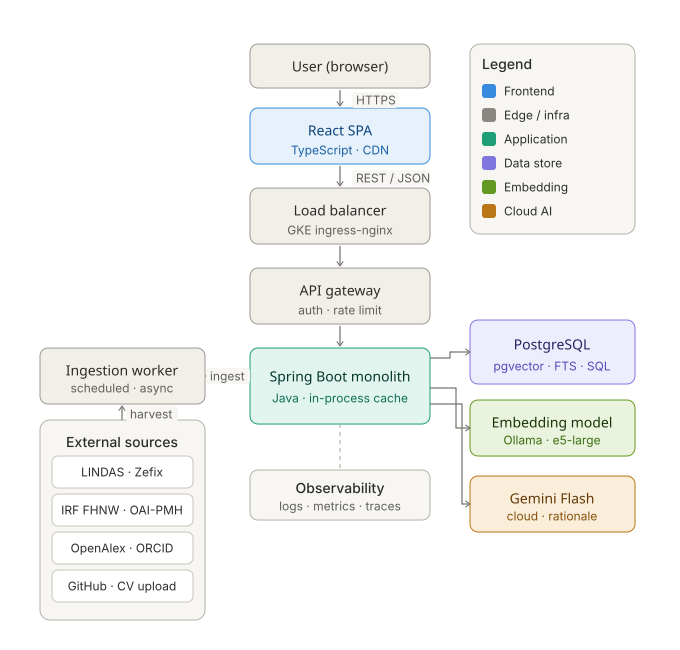
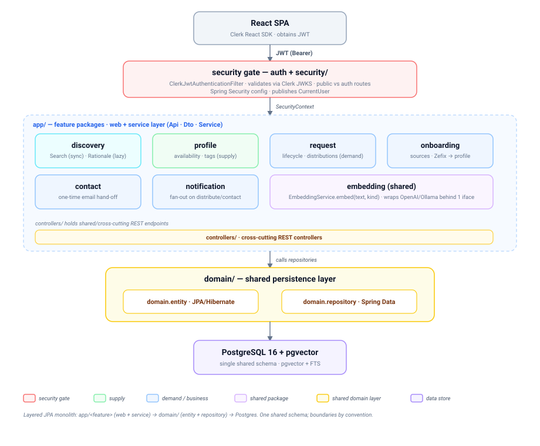

# Orbit — System Design

> **Status:** AP-SystemDesign deliverable. Describes the runtime topology and the backend
> package structure the Spring Boot application is built against.
> **Scope:** architecture and backend layout. The persistence schema lives in `02_data_model.md`;
> user stories in `01_user_stories_moscow.md`. This document is the bridge between them.
> **Naming:** `Orbit` (product) = `BadenConnect` (legacy). Java packages still read
> `ch.fhnw.badenconnect` / `com.orbit.app`; same product.

---

## 1. Overview

Orbit is a semantic matchmaking platform for the Swiss innovation ecosystem. Two surfaces sit on
one data layer: a public **Request Board** (Anfrage-Board, no login to read) and a **Discovery
Engine** (free-text semantic search with cited rationale). The runtime is deliberately lean: a
React SPA, a single Spring Boot application, one PostgreSQL database carrying both relational data
and vectors, and two AI models — a local embedding model for retrieval and a hosted LLM for the
match rationale.

The whole stack is a **modular monolith**, not microservices. There is one deployable backend.
Feature boundaries are enforced by package convention, not by network calls or separate services.
This is the right call for a thesis-scale system: it keeps the matching pipeline in one process,
avoids distributed-systems overhead, and still leaves clean seams to split later if needed.

---

## 2. Runtime topology



The request path top to bottom:

**React SPA (TypeScript, served from CDN).** The single-page app renders all three surfaces:
the Request Board, the Discovery search, and authenticated profile/request management. Anonymous
users can read the board and run a search; login is only required to escalate a search into a
persisted request, or to manage a profile. Auth is handled by the **Clerk** React SDK, which
obtains a JWT the SPA attaches as a `Bearer` token on every authenticated call (see §4).

**Edge — load balancer + API gateway.** TLS termination and ingress routing (GKE `ingress-nginx`
in the target deployment), then an API-gateway concern that handles authentication enforcement and
rate limiting before requests reach the application. In the dev/thesis setup these collapse into
the Spring app's own security filter chain; the diagram shows them separately because that is the
production shape.

**Spring Boot monolith (Java).** The application core. Holds the REST API, the feature services,
the matching pipeline, and an in-process cache. Everything that produces a match — retrieval,
hybrid scoring, rank fusion, rationale orchestration — runs here in one process.

**PostgreSQL 16 + pgvector.** The single source of truth. One database stores relational rows
(entities, requests, tags, lifecycle), the `vector(1024)` embeddings for similarity search, and
the full-text-search (`tsvector`) columns for lexical search. No separate vector database — pgvector
keeps retrieval and relational joins in one query plan, which is what makes the hybrid search cheap.

**The two models** (right side of the diagram):

- **Embedding model — Ollama, `multilingual-e5-large` (1024-dim).** Runs locally/self-hosted. Turns
  text (profiles, documents, request text, and live queries) into vectors. Multilingual by design:
  a German query matches English source text without translation. This model is on the **hot path**
  of every search — the query must be embedded before retrieval can run — and on the **ingestion
  path** for every harvested document.
- **Rationale model — Gemini Flash (hosted, cloud).** Generates the plain-language "why this match"
  text from the top candidates plus their cited evidence. It is invoked **lazily**: search and
  ranking complete and return without it, and the rationale is filled in for the results actually
  shown. The system degrades gracefully if it is unavailable — results still rank, only the prose
  explanation is missing.

**Async ingestion worker (left side).** A scheduled, asynchronous job that harvests the external
sources (LINDAS/Zefix, FHNW IRF / OAI-PMH, OpenAlex/ORCID, GitHub, uploaded CVs), builds and
refreshes profiles, and writes embeddings into Postgres via the embedding model. It runs off the
request path so onboarding and re-indexing never block a user search.

**Observability.** Logs, metrics, and traces from the monolith (cross-cutting, dashed in the
diagram — it observes rather than serves).

### Why this shape

The hot path is intentionally short: SPA → gateway → monolith → Postgres, with one local embedding
call. The only cloud dependency on the user-facing path is the rationale model, and it is optional.
Everything expensive or slow — harvesting, re-embedding, profile generation — is pushed to the async
worker. One process and one database mean the four-stage matching pipeline is a sequence of in-memory
steps and SQL queries, not a choreography of services.

### The matching pipeline (runtime)

```
Request / free-text query
  → hard scope filter        (drop candidates outside the chosen radius: All / FHNW / Baden+20km / Circles)
  → embedding retrieval       (query embedded via Ollama e5-large → pgvector ANN over remaining candidates)
  → hybrid search             (pgvector similarity + Postgres FTS / BM25-style lexical)
  → reciprocal rank fusion     (combine the two rankings; re-weight by availability + presence mode)
  → LLM rationale (lazy)       (top results + cited source evidence → Gemini Flash → plain-language "why")
```

> **Note on scope:** the data model (`02_data_model.md`) pins **scope as a hard pre-filter** —
> out-of-radius rows are excluded from the candidate set before ranking, not merely down-weighted.
> Presence mode (Vor Ort / Hybrid / Remote) is the re-weighting signal, applied during fusion.

---

## 3. Backend package structure



The backend is a **layered JPA monolith**. Three layers, top to bottom:

```
app/<feature>          web + service layer    — Api · Dto · Service per feature
   │  (calls repositories)
domain/                shared persistence layer — domain.entity (JPA) · domain.repository (Spring Data)
   │
PostgreSQL 16 + pgvector   single shared schema
```

A request enters through the security gate, lands in a feature's `Api` (REST controller), is handled
by that feature's `Service`, which calls into the **shared** `domain/` layer for persistence. All
features share one domain layer and one schema — boundaries are by **package convention**, not
framework-enforced module isolation.

### The feature packages (`app/<feature>`)

Each feature package holds its own `Api` (controller), `Dto`, and `Service`. Grouped by role in the
asymmetric demand/supply concept:

| Package | Role | What it does |
|---|---|---|
| `discovery` | engine | Semantic search (synchronous) + rationale (lazy). Owns the matching pipeline orchestration. |
| `profile` | **supply** | The standing offer: availability toggle, tags, structured availability fields. |
| `request` | **demand** | The Anfrage: 4-state lifecycle (`OPEN → DISTRIBUTED → CONTACTED → CLOSED`) and distributions. |
| `onboarding` | supply intake | Source linking; Zefix → profile generation; kicks off ingestion. |
| `contact` | hand-off | One-time email introduction. No on-platform chat — a single hand-off to email. |
| `notification` | demand→supply | Fan-out on `distribute` / `contact` — notifies matching profiles and tag subscribers. |
| `embedding` | **shared** | `EmbeddingService.embed(text, kind)` — wraps the embedding provider (Ollama, OpenAI-compatible) behind one interface so the rest of the code never knows which model runs. |
| `auth` + `security/` | **gate** | Clerk JWT validation, public-vs-authenticated routing, `CurrentUser` (see §4). |

`controllers/` holds shared, cross-cutting REST endpoints that don't belong to a single feature.

### The shared domain layer (`domain/`)

One persistence layer for all features:

- **`domain.entity`** — JPA/Hibernate entities. The `documents` aggregate root owns its
  `document_chunks` children (each chunk carries text + `vector(1024)` + FTS); requests carry their
  own whole-text embedding. See `02_data_model.md` for the full schema.
- **`domain.repository`** — Spring Data repositories. The vector + FTS queries that drive hybrid
  retrieval live here as native/`@Query` methods against pgvector.

### Why layered-by-convention rather than enforced modules

At thesis scale, a single shared schema and convention-based boundaries keep the code navigable and
the matching pipeline simple — `discovery` can read a `profile` entity and a `request` entity in one
query without crossing a module wall. The cost is discipline: nothing stops a feature from reaching
into another's internals, so the convention has to be respected by hand. If Orbit later needs hard
isolation, the seams already line up with Spring Modulith's `@ApplicationModule` boundaries — each
`app/<feature>` package is a module candidate.

---

## 4. Authentication flow (Clerk → Spring)

Auth is **stateless JWT**, delegated to Clerk; Spring never stores a password or a session.

```
React SPA (Clerk React SDK)
   │  user signs in via Clerk → SDK holds a short-lived JWT
   │  every authenticated call carries:  Authorization: Bearer <jwt>
   ▼
security gate  (auth + security/)
   • ClerkJwtAuthenticationFilter validates the token against Clerk's JWKS
   • public routes (board read, search) pass through without a token
   • authenticated routes (create request, edit profile, contact) require a valid JWT
   • on success, publishes a CurrentUser into the SecurityContext
   ▼
feature Service  — reads CurrentUser for ownership / authorisation
```

Key properties:

- **JWKS validation, no shared secret.** The filter verifies the JWT signature against Clerk's
  public keys (JWKS endpoint), so the backend trusts Clerk without holding any Clerk secret on the
  hot path.
- **Public by default for reads.** Board reading and the initial semantic search need no login —
  this is core to the "search before you commit" flow. The login wall appears only when a search is
  escalated into a persisted request, or when managing a profile.
- **`CurrentUser` is the single identity object** published into the `SecurityContext` and read by
  feature services for ownership checks (e.g. only a request's owner can close it).

This keeps the backend auth surface tiny: one filter, one JWKS check, one `CurrentUser`. User
accounts in Postgres (the `users` table) hold only the claim link (`owner_user_id` on entities),
not credentials.

---

## 5. Technology summary

| Layer | Choice | Notes |
|---|---|---|
| Frontend | React + TypeScript SPA, RTK Query | Served from CDN; Clerk React SDK for auth |
| Auth | Clerk (hosted) + Spring Security filter | Stateless JWT, JWKS validation |
| Edge | GKE `ingress-nginx` + API gateway | TLS, routing, rate limit (collapses into Spring in dev) |
| Backend | Spring Boot, layered JPA monolith (Java) | Modular monolith; in-process cache |
| Persistence | Spring Data + JPA/Hibernate | `documents` → `document_chunks` aggregate |
| Database | **PostgreSQL 16 + pgvector** | One DB: relational + `vector(1024)` + FTS |
| Embedding model | **Ollama · `multilingual-e5-large`** | Local, 1024-dim, multilingual, hot path + ingestion |
| Rationale model | **Gemini Flash** | Cloud, lazy, optional (graceful degradation) |
| Ingestion | Async scheduled worker | LINDAS/Zefix, ORCID, OpenAlex, GitHub, CV upload |

---

## 6. Diagrams

- `05_system_topology.svg` — runtime topology (this directory)
- `05_package_map.svg` — backend package / layer map with auth (this directory)
- `02_er_diagram.svg` — entity-relationship diagram (see `02_data_model.md`)
