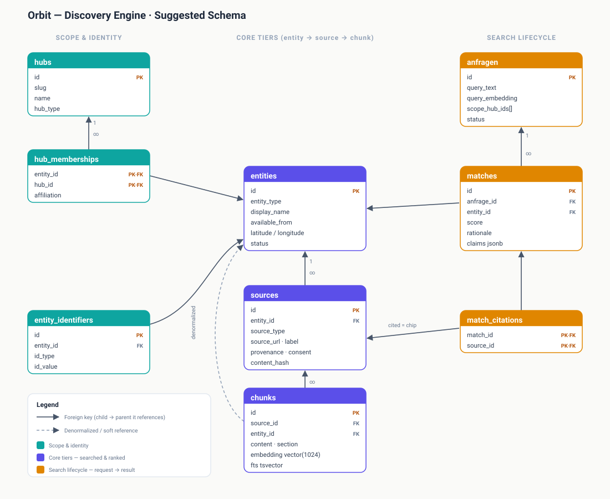

# Orbit — Discovery Engine: Unified Technical Reference

The single source of truth for the Discovery Engine. Stack: **Java Spring Boot monolith, JPA over PostgreSQL + pgvector**, `multilingual-e5-large` embeddings (1024 dims), Gemini Flash for grounded reasoning.

**How this doc is meant to be used:** the schema is introduced **incrementally** — each implementation stage (§8) ships its own Flyway migration that creates *only* the tables that stage needs. The codebase never carries entities for features that aren't built yet. §3 is the map of which table arrives in which stage; the actual `CREATE TABLE` lives inside each stage.

## Contents
1. What we're building
2. Architecture at a glance
3. Table catalog (what arrives when)
4. Ingestion pipeline — detailed
5. Discovery & match pipeline — detailed
6. End-to-end trace
7. JPA / monolith implementation notes
8. Implementation stages (incremental migrations)
9. Privacy & evaluation
10. Open decisions

---

## 1. What we're building

Given an **Anfrage** (e.g. *"Suche Embedded-Team mit Zephyr + CI für Hardware-Tests"*), optionally scoped to a **hub** (FHNW, an accelerator), return ranked **entities** (people / organizations). Each result card shows a German **rationale** explaining *why* the entity matches, and every claim is backed by a **citation chip** pointing to the source that supports it.

Defining property: **a citation can never reference evidence that wasn't retrieved.** The chunks that rank an entity are the same chunks that ground its rationale and produce its chips.

---

## 2. Architecture at a glance



> Diagram file: `orbit-schema-diagram.svg`, kept alongside this document — it renders as an image. If it doesn't resolve in your viewer, open the SVG directly.

Three zones; the centre is a three-tier hierarchy `entity → source → chunk`. We search over chunks, roll scores up to entities, scope by hub membership, and explain matches with cited reasoning.

---

## 3. Table catalog (what arrives when)

The full schema, but each table is tagged with the stage that creates it. Nothing is created before the feature that uses it.

| Table | Zone | Purpose | Created in |
|---|---|---|---|
| `entities` | core | the thing we rank & show on a card | **Stage 1** |
| `entity_identifiers` | identity | entity resolution / dedup (one ORCID = one entity) | **Stage 1** |
| `sources` | core | one evidence feed per entity; also the citation layer | **Stage 1** |
| `chunks` | core | the searchable unit (embedding + fts) | **Stage 1** |
| `hubs` | scope | scope namespaces (FHNW, accelerator) | **Stage 3** |
| `hub_memberships` | scope | many-to-many entity↔hub; the hard-filter join | **Stage 3** |
| `anfragen` | lifecycle | the request / Anfrage-Board | **Stage 4** |
| `matches` | lifecycle | persisted grounded rationale per (anfrage, entity) | **Stage 4** |
| `match_citations` | lifecycle | validated citations = the chips | **Stage 4** |

Functions: `hybrid_search` (unscoped) arrives in **Stage 2**, is replaced by the scoped version in **Stage 3**.

---

## 4. Ingestion pipeline — detailed

Ingestion runs **per source** and must be **idempotent** (safe to re-run) and **convergent** (multiple sources for the same person land on one entity). The ordering is load-bearing: **resolve identity before creating anything; dedup before embedding.**

### 4.1 Per-source extraction spec

For each `source_type`, this is exactly what to fetch, what to embed, and which external identifier resolves it onto an entity.

| `source_type` | Fetch mechanism | Embed (high-signal core) | `label` (chip text) | External id(s) for resolution | Metadata to keep |
|---|---|---|---|---|---|
| `github` | GitHub REST `/repos/{owner}/{repo}` + `/readme` | README markdown (stripped of badges/HTML) + repo description + topics | `github.com/{owner}/{repo}` | `github_login` = `{owner}` | stars, primary language, pushed_at |
| `orcid_pub` | ORCID `/works` → DOIs → OpenAlex/Crossref for title+abstract | title + abstract (one chunk if ≤512 tok) | `«{title}» ({year})` | `orcid` = the iD; also `doi` | year, DOI, venue, co-author ORCIDs |
| `zefix` | Zefix API or LINDAS SPARQL | the **Zweck** (registered purpose) | company legal name | `zefix_uid` = UID (CHE-…) | legal form, status, address, founding date |
| `personal_site` | crawl; strip nav/footer/cookie/scripts | About + projects sections | domain | `domain` (registrable) | last-fetched, title |
| `company_site` | crawl | About / products / team sections | domain | `domain` | last-fetched |
| `linkedin_pdf` | user upload → PDF text extraction | headline + About + each role (split per section) | "LinkedIn-Profil" | `linkedin_url` (from PDF/known) | role dates, companies |

Extraction rules common to all: **strip boilerplate before embedding** (cookie banners, nav, badge images, repo license headers) — embedding noise degrades retrieval more than missing text does.

### 4.2 The ingestion algorithm (precise)

```text
ingestSource(ref):                       # ref = {url, source_type, provenance, consent_basis, hub_slug?}

  # 1. FETCH ---------------------------------------------------------------
  raw       = fetchRaw(ref)              # API / SPARQL / crawl / PDF parse  (see 4.1)
  coreText  = extractHighSignalCore(raw, ref.source_type)
  label     = buildLabel(raw, ref.source_type)
  hash      = sha256(normalize(coreText))   # normalize = trim + collapse whitespace + lowercase

  # 2. DEDUP ---------------------------------------------------------------
  existing = sources.findByUrl(ref.url)
  if existing != null and existing.content_hash == hash:
      return SKIPPED                     # unchanged → no re-fetch cost paid downstream, no re-embed

  # 3. RESOLVE IDENTITY (before creating an entity) ------------------------
  ids = extractExternalIds(raw, ref.source_type)   # e.g. [(github_login, "sentio-robotics")]
  entity = entityIdentifiers.findEntityByAnyId(ids)        # unique(id_type,id_value) lookup
  if entity == null:
      entity = entities.create(deriveProfile(raw, ref.source_type))   # name, headline, org, lat/lng if known
      entityIdentifiers.insertAll(entity.id, ids)
  else:
      entityIdentifiers.insertMissing(entity.id, ids)      # converge new ids onto the same entity

  # 4. UPSERT SOURCE -------------------------------------------------------
  source = sources.upsertByUrl(
      entity_id=entity.id, source_type=ref.source_type, source_url=ref.url,
      label=label, provenance=ref.provenance, consent_basis=ref.consent_basis,
      raw_content=raw.text, content_hash=hash, fetch_status='ok', fetched_at=now())

  # 5. RE-CHUNK (delete old chunks for this source, then rebuild) ----------
  chunks.deleteBySource(source.id)       # idempotent rebuild on content change
  segments = recursiveSplit(coreText,
                 maxTokens=400, overlapTokens=60,
                 tokenizer=e5Tokenizer,            # the REAL e5 tokenizer, not chars/4
                 boundaries=[SECTION, PARAGRAPH, SENTENCE])

  # 6. EMBED + PERSIST CHUNKS ---------------------------------------------
  for i, seg in enumerate(segments):
      vec = embed("passage: " + seg.text)          # e5 REQUIRES the 'passage: ' prefix
      chunks.insert(
          source_id=source.id, entity_id=entity.id, chunk_index=i,
          content=seg.text,                          # stored WITHOUT the prefix
          section=seg.section, token_count=seg.tokenCount,
          embedding=vec, embedding_model='multilingual-e5-large', embedded_at=now())

  # 7. SCOPE (Stage 3+) ----------------------------------------------------
  if ref.hub_slug != null:
      hubMemberships.ensure(entity.id, hubs.idBySlug(ref.hub_slug), affiliation=ref.affiliation)

  return INGESTED(entity.id, source.id, len(segments))
```

### 4.3 Detail that matters for a correct implementation

- **Idempotency key = `sources.url`.** Re-ingesting the same URL updates the existing source row (`upsertByUrl`) and rebuilds its chunks; it does not create duplicates. `content_hash` short-circuits before any embedding when nothing changed.
- **Entity resolution lookup (`findEntityByAnyId`).** Query `entity_identifiers` for any `(id_type, id_value)` in `ids`; if multiple ids resolve to *different* entities, that's an entity-merge case — for Stage 1, log and attach to the first; proper merge handling is Stage 5.
- **Chunking parameters.** `maxTokens=400`, `overlapTokens=60` (~15%). Split on the largest boundary that fits: section heading → paragraph → sentence. Keep `section` (e.g. `"Methods"`, `"about"`, repo `"README"`) for later filtering and to optionally prepend to the embedded text (`"Methods: …"`).
- **Token counting.** Use the actual e5 tokenizer (HuggingFace `intfloat/multilingual-e5-large` via DJL) — German compounds make chars/4 badly wrong. Store `token_count` and assert `< 512`.
- **Embedding prefixes are not optional.** Stored passages: `"passage: " + text`. Query side (§5): `"query: " + text`. The raw `content` column stores text **without** the prefix; the prefix is added only at embed time.
- **Embedding source.** Local Ollama or LM Studio serving `multilingual-e5-large`; one vector per chunk; batch where the server supports it.
- **Failure handling.** On fetch failure set `sources.fetch_status='error'` and skip chunk rebuild (keep the last good chunks). Ingestion is a queued/scheduled job per source; a full re-harvest is re-running with dedup absorbing the no-ops.

---

## 5. Discovery & match pipeline — detailed

```text
search(query_text, scope_hub_ids, created_by):

  1. PREP
     q_emb   = embed("query: " + query_text)        # 'query: ' prefix
     anfrage = anfragen.insert(query_text, q_emb, scope_hub_ids, status='open')

  2. RETRIEVE  (see 5.1 / 5.2)
     SET LOCAL hnsw.iterative_scan = 'strict_order'
     ranked = hybrid_search(query_text, q_emb, scope_hub_ids, match_count=10)
     # returns entities ranked by RRF score; chunk scores already rolled up to entity

  3. EVIDENCE  (see 5.3)
     for entity in ranked: entity.evidence = topWinningChunks(entity, q_emb, k=4)

  4. (RERANK)  optional: ranked = crossEncoderRerank(query_text, ranked)

  5. GENERATE  (see 5.4) — only for the entities actually shown
     for entity in ranked[:10]:
         out = geminiFlash(groundingPrompt(query_text, entity, entity.evidence))

  6. VALIDATE  (see 5.5)
     allowed   = {e.id for e in entity.evidence}
     out.claims = [c for c in out.claims if set(c.source_ids) ⊆ allowed]
     chips      = [e for e in entity.evidence if e.id in out.cited_source_ids]

  7. PERSIST + RENDER
     m = matches.upsert(anfrage.id, entity.id, entity.score, out.rationale, out.claims)
     match_citations.replaceAll(m.id, [chip.source_id for chip in chips])
     anfrage.status = 'matched'
     card = render(entity, out.rationale, chips, availability, distanceToHub)
```

### 5.1 Retrieval = keyword + semantic, fused by RRF

Two independent rankings over `chunks`:
- **Keyword:** `fts @@ websearch_to_tsquery('german', query_text)`, ranked by `ts_rank_cd`.
- **Semantic:** `embedding <#> query_embedding` (negative inner product; smaller = closer for `vector_ip_ops`).

Fused with **Reciprocal Rank Fusion**: for each list a row's contribution is `weight / (rrf_k + rank_in_list)`, summed across lists. `rrf_k = 50` damps the influence of any single list's top ranks; weights let you bias keyword vs semantic. RRF is used because it combines rankings without needing the two score scales to be comparable.

Each leg pulls `match_count * 4` rows (over-fetch) so the fusion has enough overlap to work with before the final `limit`.

### 5.2 The scoped `hybrid_search` (Stage 3 version)

The scope filter joins `hub_memberships` **inside both CTEs**, before each leg's `limit` — filtering after the CTEs would let out-of-scope rows consume the limit and starve a small hub (FHNW might be 200 of ~700k entities). `hnsw.iterative_scan` makes the vector index keep scanning until it has enough in-scope rows. (Stage 2 ships the same function **without** the two `join hub_memberships` lines and without `scope_hub_ids`.)

```sql
create or replace function hybrid_search(
  query_text      text,
  query_embedding vector(1024),
  scope_hub_ids   bigint[],            -- empty array = all hubs (unscoped)
  match_count     int,
  full_text_weight float = 1,
  semantic_weight  float = 1,
  rrf_k            int   = 50
) returns table(entity_id bigint, score double precision)
language sql as $$
with full_text as (
  select c.entity_id,
         row_number() over (
           order by ts_rank_cd(c.fts, websearch_to_tsquery('german', query_text)) desc
         ) as rank_ix
  from chunks c
  join hub_memberships m
    on m.entity_id = c.entity_id
   and (cardinality(scope_hub_ids) = 0 or m.hub_id = any(scope_hub_ids))
  where c.fts @@ websearch_to_tsquery('german', query_text)
  limit least(match_count, 30) * 4
),
semantic as (
  select c.entity_id,
         row_number() over (order by c.embedding <#> query_embedding) as rank_ix
  from chunks c
  join hub_memberships m
    on m.entity_id = c.entity_id
   and (cardinality(scope_hub_ids) = 0 or m.hub_id = any(scope_hub_ids))
  limit least(match_count, 30) * 4
),
fused as (
  -- one row per (entity, leg-rank): rolls chunk-level ranks up to the entity here
  select coalesce(f.entity_id, s.entity_id) as entity_id,
         coalesce(1.0/(rrf_k + f.rank_ix), 0.0) * full_text_weight +
         coalesce(1.0/(rrf_k + s.rank_ix), 0.0) * semantic_weight as score
  from full_text f
  full outer join semantic s on f.entity_id = s.entity_id
)
select entity_id, max(score) as score      -- MAX rollup: best signal per entity
from fused
group by entity_id
order by score desc
limit least(match_count, 30);
$$;
```

> Note: because a `join` to `hub_memberships` requires a membership row to exist, **every ingested entity must have at least one hub membership** for it to be searchable in Stage 3+. Assign a default hub (e.g. a catch-all `'all'` hub, or the source's origin hub) during ingestion step 7. In Stage 2 (no hubs) the function omits the join and this constraint doesn't apply.

**Rollup choice:** `max(score)` per entity = "the entity with the single strongest matching chunk wins" — one excellent chunk shouldn't lose to an entity with many mediocre ones. Alternative `sum(score)` rewards matching on several fronts; this is a tunable, A/B-able decision (a thesis evaluation point).

### 5.3 Capturing the winning chunks (the evidence)

`hybrid_search` returns ranked entities. For each shown entity, fetch its top chunks for *this* query to use as evidence — these are what the generator explains, so they must be the chunks that actually drove relevance:

```sql
-- top-k winning chunks for one entity, for this query
select ch.id, ch.content, ch.section, s.id as source_id, s.source_type, s.label, s.source_url
from chunks ch
join sources s on s.id = ch.source_id
where ch.entity_id = :entity_id
  and (cardinality(:scope_hub_ids) = 0 or exists (
        select 1 from hub_memberships m
        where m.entity_id = ch.entity_id and m.hub_id = any(:scope_hub_ids)))
order by ch.embedding <#> :query_embedding      -- closest chunks to the query
limit :k;                                        -- k = 3..5
```

Assign each evidence row a short stable id (`S1, S2, …`) per entity for the grounding step. Dedup by `source_id` if two chunks come from the same source so a source yields one chip.

### 5.4 Grounded generation (Gemini Flash)

Generate **only for the entities actually shown** (≤10) to keep cost bounded. The model sees only the query, a thin entity profile, and the winning chunks — never the full entity.

**Request shape** (low temperature, JSON-constrained via `responseSchema`):

```jsonc
// system: "Du bist ein Matching-Assistent. Nutze AUSSCHLIESSLICH die bereitgestellten
//          Belege (evidence). Mache keine Aussage, die nicht durch die Belege gestützt ist.
//          Zitiere für jede Aussage die source_id(s). Antworte NUR als JSON. Sprache: Deutsch."
// user:
{
  "anfrage": "Suche Embedded-Team mit Zephyr + CI für Hardware-Tests",
  "entity":  { "name": "David Aregger", "role": "CTO & Mitgründer",
               "org": "Sentio Robotics GmbH, Baden" },
  "evidence": [
    { "id": "S1", "type": "orcid_pub", "label": "«HIL-Testing at Scale» (Embedded World 2025)", "text": "…abstract…" },
    { "id": "S2", "type": "github",    "label": "github.com/sentio-robotics/zephyr-ci",          "text": "…README chunk…" },
    { "id": "S3", "type": "company_site", "label": "sentio-robotics.ch",                         "text": "…about chunk…" }
  ]
}
```

**`responseSchema`** (enforced JSON output):

```jsonc
{
  "type": "object",
  "properties": {
    "rationale": { "type": "string" },                       // German, 1–3 sentences
    "claims": {
      "type": "array",
      "items": { "type": "object",
        "properties": { "text": {"type":"string"},
                        "source_ids": {"type":"array","items":{"type":"string"}} },
        "required": ["text","source_ids"] }
    },
    "cited_source_ids": { "type": "array", "items": {"type":"string"} }
  },
  "required": ["rationale","claims","cited_source_ids"]
}
```

### 5.5 Citation validation (non-negotiable)

The model can still emit an id that wasn't provided. Drop any such claim *before* anything reaches the UI; the surviving cited ids become the chips.

```java
Set<String> allowed = evidence.stream().map(Evidence::id).collect(toSet());

// 1. discard hallucinated claims
result.claims().removeIf(c -> !allowed.containsAll(c.sourceIds()));

// 2. recompute cited set from surviving claims (don't trust the model's own list)
Set<String> cited = result.claims().stream()
    .flatMap(c -> c.sourceIds().stream()).collect(toSet());

// 3. chips = evidence whose id survived
List<Evidence> chips = evidence.stream()
    .filter(e -> cited.contains(e.id())).toList();

// 4. if no claim survived, the entity has no grounded rationale → drop it from results
if (chips.isEmpty()) return Optional.empty();
```

`chips` → `match_citations` rows; `result.rationale` + `result.claims` → the `matches` row. A citation referencing an id we didn't pass can never reach a card.

### 5.6 Render payload

```jsonc
{
  "entity": { "name": "...", "headline": "...", "org": "..." },
  "available_from": "2025-07-01",                       // → "Verfügbar ab 1. Juli"
  "distance": "8 Min. von FHNW Brugg",                  // computed: entity lat/lng vs hub anchor lat/lng
  "rationale": "Davids Startup baut Inspektionsroboter …",
  "chips": [ { "label": "«HIL-Testing at Scale» (Embedded World 2025)", "url": "...", "type": "orcid_pub" },
             { "label": "github.com/sentio-robotics/zephyr-ci", "url": "...", "type": "github" } ]
}
```
`distance` is computed at query time (haversine between `entities.lat/lng` and the scoped hub's anchor, optionally a routing API for "minutes"); it is not stored on the match.

---

## 6. End-to-end trace (worked example)

Query *"Suche Embedded-Team mit Zephyr + CI für Hardware-Tests"*, scoped to FHNW.

1. **Ingestion (earlier).** Sentio's `zephyr-ci` repo, David's Embedded World 2025 paper (via ORCID→OpenAlex), and `sentio-robotics.ch` were each ingested. All three resolved onto one entity *David Aregger* via `github_login`, `orcid`, and `domain`; chunked, embedded with `passage:`, and given an FHNW `hub_membership`.
2. **Retrieve.** Query embeds with `query:`. Scoped `hybrid_search` ranks chunks; the README chunk (Zephyr CI) and the paper abstract both rank high. `max` rollup gives *David Aregger* a strong entity score.
3. **Evidence.** Top winning chunks → `S1` (paper), `S2` (repo), `S3` (site).
4. **Generate.** Gemini Flash returns a German rationale citing `S1, S2` for the Zephyr/CI claim.
5. **Validate.** `S1, S2` ∈ allowed → kept. `S3` not cited → not a chip.
6. **Render.** Card: rationale, chips for paper + repo, "Verfügbar ab 1. Juli", "8 Min. von FHNW Brugg".

---

## 7. JPA / monolith implementation notes

Plain monolith → normal JPA associations (`@ManyToOne` / `@OneToMany`) across all tables. No module-boundary workarounds.

- **`vector(1024)`** → map via `hibernate-vector` (Hibernate 6.4+). Don't store as `String`.
- **`fts tsvector`** → DB-generated; map read-only (`@Column(insertable=false, updatable=false)`); never write from JPA.
- **`scope_hub_ids bigint[]`, `claims jsonb`** → explicit Hibernate type mappings (array / JSON); they don't default.
- **`hub_memberships`** has an attribute (`affiliation`) → model as its own `@Entity` with `@EmbeddedId`, **not** `@ManyToMany`.
- **Schema authority** → the per-stage Flyway migrations are the source of truth. `ddl-auto: validate`. Hibernate won't generate HNSW indexes or generated `tsvector` columns correctly.

---

## 8. Implementation stages (incremental migrations)

Each stage adds **only** the tables it needs, via its own migration, and ends at a checkpoint with a runnable done-command. Implement one stage per session/commit; review the diff before the next. Tell the agent the stage's scope **and** its "does NOT touch" list.

### Stage 1 — Ingestion of one source type (GitHub)
**Migration `V1__core_ingestion.sql`** creates: `entities`, `entity_identifiers`, `sources`, `chunks` (+ their indexes).
```sql
create extension if not exists vector;

create table entities (
  id bigint primary key generated always as identity,
  entity_type text not null, display_name text not null,
  headline text, org_name text,
  latitude double precision, longitude double precision,
  available_from date, status text not null default 'active',
  metadata jsonb default '{}',
  created_at timestamptz not null default now(),
  updated_at timestamptz not null default now()
);
create table entity_identifiers (
  id bigint primary key generated always as identity,
  entity_id bigint not null references entities(id) on delete cascade,
  id_type text not null, id_value text not null,
  unique (id_type, id_value)
);
create table sources (
  id bigint primary key generated always as identity,
  entity_id bigint not null references entities(id) on delete cascade,
  source_type text not null, source_url text, label text,
  provenance text not null default 'harvested', consent_basis text,
  raw_content text, content_hash text,
  fetch_status text default 'ok', fetched_at timestamptz,
  created_at timestamptz not null default now(),
  unique (source_url)
);
create index on sources (entity_id);
create table chunks (
  id bigint primary key generated always as identity,
  source_id bigint not null references sources(id) on delete cascade,
  entity_id bigint not null references entities(id),
  chunk_index int not null, content text not null, section text, token_count int,
  fts tsvector generated always as (to_tsvector('german', content)) stored,
  embedding vector(1024),
  embedding_model text default 'multilingual-e5-large', embedded_at timestamptz,
  created_at timestamptz not null default now()
);
create index on chunks using gin  (fts);
create index on chunks using hnsw (embedding vector_ip_ops);
create index on chunks (entity_id);
create index on chunks (source_id);
```
**Implements:** §4 ingestion for `source_type='github'` only — fetch → dedup → resolve → upsert source → chunk → embed (`passage:`) → persist.
**Done (command):** an integration test ingests a real/fixture repo URL and asserts: exactly 1 entity, ≥1 chunk with a non-null 1024-dim embedding, `token_count < 512`; **re-running the same URL returns SKIPPED and creates no new rows.** e.g. `./gradlew test --tests IngestionGithubTest`.
**Does NOT touch:** hubs, anfragen, matches, any retrieval/search code, any other source type.

### Stage 2 — Unscoped retrieval
**Migration `V2__hybrid_search.sql`** creates: the `hybrid_search` **function without** the hub join / `scope_hub_ids` (no new tables).
**Implements:** §5.1–5.3 minus scope — embed query (`query:`), call function, RRF, `max` rollup, capture winning chunks.
**Done (command):** seed 2–3 entities via Stage 1 ingestion; a query returns the expected top entity and exactly one row per entity. `./gradlew test --tests HybridSearchTest`.
**Does NOT touch:** hubs, generation, persistence of matches.

### Stage 3 — Scope (hubs)
**Migration `V3__hubs.sql`** creates: `hubs`, `hub_memberships`; and `create or replace` the **scoped** `hybrid_search` (the §5.2 version).
```sql
create table hubs (
  id bigint primary key generated always as identity,
  slug text not null unique, name text not null, hub_type text,
  latitude double precision, longitude double precision,
  created_at timestamptz not null default now()
);
create table hub_memberships (
  entity_id bigint not null references entities(id) on delete cascade,
  hub_id bigint not null references hubs(id) on delete cascade,
  affiliation text, joined_at timestamptz not null default now(),
  primary key (entity_id, hub_id)
);
create index on hub_memberships (hub_id);
-- + create or replace function hybrid_search(... scope_hub_ids ...) as in §5.2
```
**Implements:** ingestion step 7 (assign hub membership; backfill a default hub for Stage 1/2 entities); scoped search with `SET LOCAL hnsw.iterative_scan`.
**Done (command):** the same query scoped to hub A returns only hub-A entities; a deliberately small hub still returns its in-scope matches (not starved). `./gradlew test --tests ScopedSearchTest`.
**Does NOT touch:** generation, matches.

### Stage 4 — Grounded matches (Anfrage + reasoning + citations)
**Migration `V4__matches.sql`** creates: `anfragen`, `matches`, `match_citations`.
```sql
create table anfragen (
  id bigint primary key generated always as identity,
  created_by bigint, query_text text not null, query_embedding vector(1024),
  scope_hub_ids bigint[], status text not null default 'open',
  created_at timestamptz not null default now()
);
create table matches (
  id bigint primary key generated always as identity,
  anfrage_id bigint not null references anfragen(id) on delete cascade,
  entity_id bigint not null references entities(id) on delete cascade,
  score double precision, rationale text, claims jsonb,
  created_at timestamptz not null default now(),
  unique (anfrage_id, entity_id)
);
create table match_citations (
  match_id bigint not null references matches(id) on delete cascade,
  source_id bigint not null references sources(id) on delete cascade,
  primary key (match_id, source_id)
);
```
**Implements:** §5.4–5.6 — persist anfrage; Gemini Flash grounded generation with `responseSchema`; citation validation; persist `matches` + `match_citations`; render payload.
**Done (command):** a query yields a persisted match whose `match_citations` are a subset of the entity's evidence ids; a unit test feeding a deliberately hallucinated citation asserts it is dropped and never reaches `chips`. `./gradlew test --tests GroundedMatchTest`.
**Does NOT touch:** —

### Stage 5 — Hardening (after the vertical works end to end)
Additional `source_type`s (one migration-free unit each — no schema change, just new extractors); entity-merge handling for conflicting ids; optional cross-encoder reranker; match freshness rule (regenerate when a source's `content_hash` changed after `matches.created_at`); evaluation harness.

> **Per-stage prompt template for the agent:**
> *"Read `orbit-discovery-engine-reference.md`. Implement only Stage N from §8, following §4/§5 and the §7 JPA notes. Create only that stage's migration and the code it requires. Do not create tables or code for later stages. Stop when `[done-command]` passes, then show me the diff."*

---

## 9. Privacy & evaluation

- **Privacy (revFADP / GDPR).** LinkedIn PDFs and personal-site data are personal data; user-upload-your-own-profile is a defensible consent basis (recorded in `sources.provenance` / `consent_basis`); scraping LinkedIn would not be. Note lawful basis + retention in the concept doc.
- **Evaluation (thesis).** precision@k / recall@k of returned entities; ranking ablation (RRF weights, `max` vs `sum` rollup, ± reranker); **citation precision** (do cited sources actually support the claim) — measures grounding, made auditable by persisted `matches`.

---

## 10. Open decisions (settle before Stage 4, ideally before Stage 1)

- **users/accounts table** — `anfragen.created_by` points at it. Decide now whether it exists or is a bare id.
- **`claims` jsonb vs normalized** `match_claims` — jsonb maps to generator output; normalize only if you need to query individual claims.
- **Persist vs compute `matches`** — persisted here (matches pin to the Anfrage-Board; must be stable + auditable). If matching were purely transient live search, Stage 4's `matches`/`match_citations` could be dropped and generated on the fly.
- **Default hub policy** — Stage 3 requires every searchable entity to have ≥1 membership. Decide: a catch-all `'all'` hub vs. origin-derived hubs.
- **Hard vs soft scope** — hard filter now; `hub_memberships` also supports a future soft-boost (RRF bonus instead of `WHERE`).
