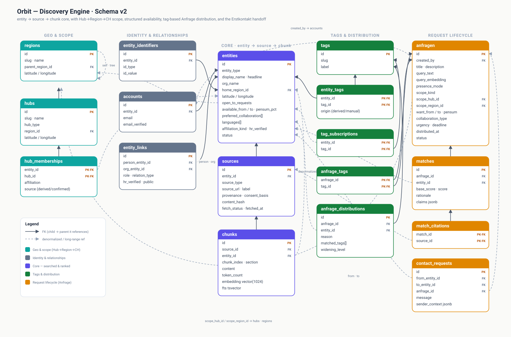

# Orbit — Discovery Engine: Unified Technical Reference (v2)

The single source of truth for the Discovery Engine. Stack: **Java Spring Boot monolith, JPA over PostgreSQL + pgvector**, `multilingual-e5-large` embeddings (1024 dims), Gemini Flash for grounded reasoning.

**What changed in v2.** This revision tracks **Orbit Spec v2** (Norbert feedback, 22.06.2026) and the HighFi flows (Demand / Supply / Onboarding). The retrieval core is unchanged on purpose — three-tier `entity → source → chunk`, hybrid BM25 + pgvector, RRF, `max` rollup, persisted grounded matches with validated citations all stay exactly as they were. What v2 *adds*:

- **Scope is now Hub → Region → CH**, not a flat list of hubs and not a radius. Hubs roll into regions, regions into CH; the hard filter widens up that tree (§5).
- **Geography, affiliation, and presence are three separate axes** (§5.2, §7). Distance is a re-rank signal, not a hub.
- **Structured availability** (date range + Pensum % + preferred collaboration) lives on the entity and drives re-ranking (§6.3).
- **A real re-ranking stage** after retrieval: availability overlap, presence alignment, proximity, hub overlap (§6).
- **Pull vs push are different mechanisms.** Live *search* is semantic (the embedding pipeline). *Distribution* of an Anfrage to standing profiles is **rule-based on tags + scope** so it stays explainable ("verteilt, weil dein Profil die Tags … trägt") (§8).
- **Anfrage lifecycle** Offen → Verteilt → Kontaktiert → Geschlossen, with urgency-driven widening (§8).
- **Tags / skills / subscriptions**, **accounts + verified email**, **Person↔Org links**, **HR-verified**, and the **first-contact handoff with sender context** (§9–§11).

**Implementation update (July 2026).** The reference was written as a design doc; the sections below now carry **implementation notes** where the built system diverged from or extended the original design. Key implementation decisions:

- **Cross-encoder reranking is no longer optional.** A deterministic cross-encoder (BAAI/bge-reranker-v2-m3, served via a Python microservice on port 8001) was added as Stage 2 of a **5-stage pipeline**: retrieve → soft re-rank → cross-encoder rerank → LLM ground → render. The LLM (Gemini) now only *explains* matches; it never decides who gets in. See §6.7.
- **FTS uses English, not German.** Queries are translated to English by Gemini before retrieval, and the `hybrid_search` function uses `websearch_to_tsquery('english', …)`. This was done because the entity summaries and chunk content are generated/stored in English (by the LLM enrichment), even though the UI and rationale output are in German. See §6.1.
- **No JPA associations.** The built system uses plain `Long` FKs resolved via repository calls, not `@ManyToOne`/`@OneToMany`. This avoids Hibernate lazy-loading issues and N+1 queries. See §13.
- **Auth uses Clerk + a `users` table**, not the `accounts` table from the original design. Clerk JWTs are validated as OAuth2 resource-server tokens; a `UserProvisioningFilter` JIT-upserts a local `users` row on first auth. See §10.
- **Profile mode (V9).** A `profile_mode` column (`supply` | `demand`) on `entities` controls whether the own-profile UI shows supply editors (availability, subscribed topics) or hides them. Set by the onboarding fork; switchable on the profile.

**How this doc is meant to be used:** the schema is introduced **incrementally** — each implementation stage (§14) ships its own Flyway migration that creates *only* the tables that stage needs. The codebase never carries entities for features that aren't built yet. §3 is the map of which table arrives in which stage; the actual `CREATE TABLE` lives inside each stage. The full grounded vertical (scoped search → grounded card) still works end-to-end by **Stage 4**; everything after that layers richness onto a working system.

## Contents
1. What we're building
2. Architecture at a glance
3. Table catalog (what arrives when)
4. Ingestion pipeline — detailed
5. Scope model — Hub → Region → CH
6. Discovery & match pipeline — retrieve → soft re-rank → cross-encoder rerank → ground
7. Hard vs soft filters (the filter reference)
8. Anfrage lifecycle & distribution
9. Tags, skills & subscriptions
10. Identity, accounts & Person↔Org links
11. Contact handoff (sender context, gating)
12. End-to-end trace
13. JPA / monolith implementation notes (IMPLEMENTED)
14. Schema
15. Open decisions

---

## 1. What we're building

Orbit is **asymmetric**: *Nachfrage handelt, Angebot wartet.* Demand is an active, lifecycle-bearing **Anfrage**; supply is a standing **profile** that is found, never a post. Both sides write into one data model — there is no "Angebot" object.

The engine serves two distinct jobs:

- **Pull (search).** Given an **Anfrage / query** (e.g. *"Suche Embedded-Team mit Zephyr + CI für Hardware-Tests"*), scoped to **Alle / a hub / a region**, return ranked **entities** (people / organizations). Each result card shows a German **rationale** with a **citation chip** per claim, a **distance** ("12 Min. von FHNW Brugg"), and a structured **availability pill** ("60 % · 1. Aug – 31. Okt"). This is the semantic pipeline (§6).
- **Push (distribution).** When a query isn't enough, the Anfrage becomes a persistent public object on the Anfrage-Board and is **distributed** to matching standing profiles and tag-subscribers. Distribution is **rule-based on tags + scope**, not semantic, so the "why you were notified" reason is exact and explainable (§8).

Defining property of the pull path (unchanged from v1): **a citation can never reference evidence that wasn't retrieved.** The chunks that rank an entity are the same chunks that ground its rationale and produce its chips.

---

## 2. Architecture at a glance



> Diagram file: `orbit-schema-diagram.svg`, kept alongside this document — it renders as an image. If it doesn't resolve in your viewer, open the SVG directly.

Five zones. The centre is still the three-tier hierarchy `entity → source → chunk` — we search over chunks, roll scores up to entities, scope by the geography zone, re-rank by the soft signals, explain matches with cited reasoning, and (for push) distribute by tags.

- **Core tiers** (`entities`, `sources`, `chunks`) — searched & ranked. `entities` now also carries structured availability and affiliation.
- **Geo & scope** (`regions`, `hubs`, `hub_memberships`) — the Hub → Region → CH tree and the hard-filter join.
- **Identity & relationships** (`entity_identifiers`, `accounts`, `entity_links`) — resolution/dedup, login, Person↔Org.
- **Tags & distribution** (`tags`, `entity_tags`, `anfrage_tags`, `tag_subscriptions`, `anfrage_distributions`) — the push path.
- **Request lifecycle** (`anfragen`, `matches`, `match_citations`, `contact_requests`) — request → grounded result → first contact.

---

## 3. Table catalog (what arrives when)

The full schema, each table tagged with the stage that creates it. Nothing is created before the feature that uses it. Columns added to an existing table by a later stage are noted as **ALTER**.

| Table / change | Zone | Purpose | Created in |
|---|---|---|---|
| `entities` | core | the thing we rank & show on a card | **Stage 1** |
| `entity_identifiers` | identity | entity resolution / dedup (one ORCID = one entity) | **Stage 1** |
| `sources` | core | one evidence feed per entity; also the citation layer | **Stage 1** |
| `chunks` | core | the searchable unit (embedding + fts) | **Stage 1** |
| `regions` | geo/scope | region tree; CH is the root | **Stage 3** |
| `hubs` | geo/scope | affiliation namespace; belongs to a region | **Stage 3** |
| `hub_memberships` | geo/scope | many-to-many entity↔hub; the hard-filter join | **Stage 3** |
| `entities.home_region_id` (ALTER) | core | region anchor (derived from location) | **Stage 3** |
| `anfragen` | lifecycle | the request / Anfrage-Board object | **Stage 4** |
| `matches` | lifecycle | persisted grounded rationale per (anfrage, entity) | **Stage 4** |
| `match_citations` | lifecycle | validated citations = the chips | **Stage 4** |
| `entities` availability cols (ALTER) | core | `open_to_requests`, `available_from/to`, `pensum_pct`, `availability_note`, `preferred_collaboration[]`, `languages[]` | **Stage 5** |
| `tags` | tags | controlled tag vocabulary | **Stage 6** |
| `entity_tags` | tags | Kompetenzen (skills), derived + manual | **Stage 6** |
| `anfrage_tags` | tags | tags carried by an Anfrage | **Stage 6** |
| `tag_subscriptions` | tags | abonnierte Themen (entity↔tag) | **Stage 6** |
| `anfrage_distributions` | distribution | who was notified, why, at which widening level | **Stage 6** |
| `accounts` | identity | login + verified email; owns one entity | **Stage 7** |
| `entity_links` | identity | Person↔Organisation | **Stage 7** |
| `entities.affiliation_kind`, `.hr_verified` (ALTER) | core/identity | Firma / Selbständig / Privatperson; HR-verified badge | **Stage 7** |
| `contact_requests` | lifecycle | first-contact handoff with sender context | **Stage 8** |

Functions: `hybrid_search` (unscoped) arrives in **V3**, is replaced by the scoped Hub→Region version in **V10**. Re-ranking (§6.3), cross-encoder reranking (§6.7), and distribution (§8) are **application-layer** (no DB function), so they add no migration of their own.

**Implementation status (July 2026):** Tables marked Stage 1–3 + Stage 5–6 + Stage 9 (profile mode) are **built** (V1–V10). Tables marked Stage 4 (`anfragen`, `matches`, `match_citations`) and Stage 8 (`contact_requests`) are **not yet built** — these are the demand-side Anfrage lifecycle, which is the next build phase. `accounts` and `entity_links` (Stage 7) were replaced by Clerk auth + a `users` table (no `accounts` table needed).

---

## 4. Ingestion pipeline — detailed

Ingestion runs **per source** and must be **idempotent** (safe to re-run) and **convergent** (multiple sources for the same person land on one entity). The ordering is load-bearing: **resolve identity before creating anything; dedup before embedding.** v2 adds three derivation outputs to ingestion — **tags** (Kompetenzen), **hub/region suggestions**, and **affiliation** — all *proposed* and then confirmed by the user in onboarding (spec §14.5 / §10).

### 4.1 Per-source extraction spec

| `source_type` | Fetch mechanism | Embed (high-signal core) | `label` (chip text) | External id(s) for resolution | Also derive |
|---|---|---|---|---|---|
| `github` | GitHub REST `/repos/{owner}/{repo}` + `/readme` | README (stripped of badges/HTML) + description + topics | `github.com/{owner}/{repo}` | `github_login` = `{owner}` | tags (topics, languages); stars, primary lang, pushed_at |
| `orcid_pub` | ORCID `/works` → DOIs → OpenAlex/Crossref for title+abstract | title + abstract (one chunk if ≤512 tok) | `«{title}» ({year})` | `orcid`; also `doi` | tags (concepts); year, venue; **ORCID affiliation → hub** |
| `zefix` | Zefix API or LINDAS SPARQL | the **Zweck** (registered purpose) | company legal name | `zefix_uid` = UID (CHE-…) | legal form, status, address → **home_region**; sets `hr_verified=true` |
| `personal_site` | crawl; strip nav/footer/cookie/scripts | About + projects | domain | `domain` (registrable) | tags; last-fetched, title |
| `company_site` | crawl | About / products / team | domain | `domain` | tags; team names → candidate `entity_links` |
| `linkedin_pdf` | user upload → PDF text extraction | headline + About + each role | "LinkedIn-Profil" | `linkedin_url` | tags; employer → **affiliation + hub candidate**; languages |
| `cv_pdf` | user upload → deterministic PDFBox text extraction | extracted CV text | uploaded filename | none (attaches to the signed-in entity) | normal enrichment derives summary + tags; scanned PDFs require future OCR |
| `manual_text` | user-typed 2–3 sentences (Demand min profile) | the text itself (one chunk) | "Eigene Beschreibung" | none (attaches to the signed-in entity) | tags (light); **consent_basis = self_declared** |

Common rules: **strip boilerplate before embedding** (cookie banners, nav, badge images, license headers) — embedding noise degrades retrieval more than missing text does. **Languages** (DE/EN/FR from the onboarding chips or parsed from sources) are stored on `entities.languages[]`, not as a source.

### 4.2 The ingestion algorithm (precise)

```text
ingestSource(ref):     # ref = {url, source_type, provenance, consent_basis, hub_slug?, region_slug?}

  # 1. FETCH ---------------------------------------------------------------
  raw       = fetchRaw(ref)                       # API / SPARQL / crawl / PDF parse (see 4.1)
  coreText  = extractHighSignalCore(raw, ref.source_type)
  label     = buildLabel(raw, ref.source_type)
  hash      = sha256(normalize(coreText))         # normalize = trim + collapse ws + lowercase

  # 2. DEDUP ---------------------------------------------------------------
  existing = sources.findByUrl(ref.url)
  if existing != null and existing.content_hash == hash:
      return SKIPPED                              # unchanged → no re-embed, no re-derive

  # 3. RESOLVE IDENTITY (before creating an entity) ------------------------
  ids = extractExternalIds(raw, ref.source_type)
  entity = entityIdentifiers.findEntityByAnyId(ids)
  if entity == null:
      entity = entities.create(deriveProfile(raw, ref.source_type))   # name, headline, org, lat/lng
      entityIdentifiers.insertAll(entity.id, ids)
  else:
      entityIdentifiers.insertMissing(entity.id, ids)                 # converge ids onto one entity

  # 4. UPSERT SOURCE -------------------------------------------------------
  source = sources.upsertByUrl(entity.id, ref.source_type, ref.url, label,
                               ref.provenance, ref.consent_basis, raw.text, hash, 'ok', now())

  # 5. RE-CHUNK (delete old chunks for this source, then rebuild) ----------
  chunks.deleteBySource(source.id)
  segments = recursiveSplit(coreText, maxTokens=400, overlapTokens=60,
                            tokenizer=e5Tokenizer, boundaries=[SECTION,PARAGRAPH,SENTENCE])

  # 6. EMBED + PERSIST CHUNKS ---------------------------------------------
  for i, seg in enumerate(segments):
      vec = embed("passage: " + seg.text)         # e5 REQUIRES the 'passage: ' prefix
      chunks.insert(source.id, entity.id, i, seg.text, seg.section, seg.tokenCount,
                    vec, 'multilingual-e5-large', now())

  # 7. DERIVE (Stage 3/6/7) — proposed, not auto-applied -------------------
  proposeTags(entity.id, deriveTags(raw, ref.source_type))            # Stage 6: entity_tags(origin='derived')
  proposeHub(entity.id, deriveHub(raw, ref))                          # Stage 3: hub_memberships(source='derived')
  setRegionIfKnown(entity.id, deriveRegion(raw, ref))                 # Stage 3: entities.home_region_id
  setAffiliationIfKnown(entity.id, deriveAffiliation(raw))            # Stage 7: affiliation_kind + entity_links

  return INGESTED(entity.id, source.id, len(segments))
```

### 4.3 Detail that matters for a correct implementation

- **Idempotency key = `sources.url`.** Re-ingesting the same URL updates the existing row (`upsertByUrl`) and rebuilds its chunks; `content_hash` short-circuits before any embedding when nothing changed.
- **Entity resolution (`findEntityByAnyId`).** Query `entity_identifiers` for any `(id_type,id_value)` in `ids`; if ids resolve to *different* entities, that's an entity-merge case — Stage 1: log + attach to the first; proper merge is Stage 9.
- **Chunking.** `maxTokens=400`, `overlapTokens=60` (~15%). Split on the largest boundary that fits: section → paragraph → sentence. Keep `section` for filtering / optional prepend.
- **Token counting.** Use the real e5 tokenizer (HF `intfloat/multilingual-e5-large` via DJL) — German compounds make chars/4 badly wrong. Store `token_count`, assert `< 512`.
- **Embedding prefixes are not optional.** Stored passages `"passage: " + text`; query side `"query: " + text`. `content` is stored **without** the prefix.
- **Embedding source.** Local Ollama or LM Studio serving `multilingual-e5-large`; one vector per chunk; batch where supported.
- **Derivation is *proposed*, never silently authoritative.** Derived tags/hubs/affiliation are written with an origin flag (`origin='derived'`, `source='derived'`) and surfaced in onboarding for the user to **confirm or change** (spec §14.5). User edits set `origin='manual'` and are never overwritten by a later re-harvest.
- **Failure handling.** On fetch failure set `sources.fetch_status='error'`, skip chunk rebuild (keep last good chunks). Ingestion is a queued/scheduled job per source; a full re-harvest is a re-run with dedup absorbing the no-ops.

---

## 5. Scope model — Hub → Region → CH

v1 had a flat list of hubs and a `scope_hub_ids` array. v2 replaces that with the spec's **Hub → Region → CH** hierarchy, because the old radius model pretended a nesting that doesn't exist (FHNW-Brugg is in Aargau, FHNW-Olten is in Solothurn — "FHNW" is not a subset of "Aargau"). **Affiliation** (a hub) and **geographic proximity** are now separate concepts.

### 5.1 The three structures

- **`regions`** form a tree. `CH` is the root (`parent_region_id = null`). The UI's *Region Baden → Aargau → Schweiz* is just three nodes on that tree; the doc's canonical *Hub → Region → CH* is the same walk generalized to nested regions. Each region may carry an anchor lat/lng.
- **`hubs`** are *affiliations* (an institution like FHNW, an incubator/accelerator, a city scene). A hub **belongs to one region** (`hubs.region_id`) and carries its own lat/lng. A hub is a membership, **not** a radius.
- **`hub_memberships`** is entity↔hub (many-to-many), with `affiliation` (e.g. "FHNW-E-Mail", "Arbeitgeber") and `source` ('derived' | 'confirmed'). An entity may belong to **several** hubs — there is no forced primary hub (spec §14.3). Re-ranking weights every overlapping hub.
- **`entities.home_region_id`** anchors an entity to a region even when it has no hub membership (derived from location). This lets a region-scoped search include hub-less profiles.

### 5.2 Three axes, kept separate

| Axis | Question | Where it lives | Effect |
|---|---|---|---|
| **Hub / Region** (affiliation) | *where is someone anchored?* | `hub_memberships`, `entities.home_region_id` | **Hard filter** in search (with widening); re-rank + escalation weight in distribution |
| **Geographic proximity** | *how far away?* | `entities.lat/lng` vs hub/region anchor | **Soft** re-rank weight only |
| **Präsenzmodus** (Vor Ort / Hybrid / Remote) | *how is the work done?* | `anfragen.presence_mode` | gates the proximity/hub weights; "Remote" damps them |

"CH" is the top **region**, never a Präsenzmodus. On **Remote**, proximity and hub weights are automatically damped ("Remote — Hub/Nähe weniger relevant").

### 5.3 Resolving a scope selection → the hard filter

A search/Anfrage carries a **scope selection**: `all`, a `hub`, or a `region`. The app resolves it to two arrays passed into `hybrid_search`, then widens by re-resolving at the next level:

```text
resolveScope(selection, wideningLevel):
  if selection.kind == 'all':            return ( hub_ids=[], region_ids=[] )      # no filter
  if selection.kind == 'hub':
     hub = selection.hub
     case wideningLevel:
       HUB    -> ( [hub.id],            [] )                                       # strict hub
       REGION -> ( [],   subtree(hub.region_id) )                                  # widen to hub's region
       CH     -> ( [],   [] )                                                       # widen to all
  if selection.kind == 'region':
     case wideningLevel:
       REGION -> ( [],   subtree(selection.region_id) )
       CH     -> ( [],   [] )
```

`subtree(R)` = R plus all descendant regions (precomputed `region_closure`, or a recursive CTE, or `ltree`). An entity is **in scope** when it is a member of a scoped hub **or** its `home_region_id` is in the scoped region subtree. Empty/empty = unscoped ("Alle" doesn't filter).

The hard filter is applied **inside both retrieval CTEs, before each leg's `limit`** — filtering after the CTEs would let out-of-scope rows consume the limit and starve a small hub (FHNW might be ~200 of ~700k entities). See §6.2 for the exact SQL.

### 5.4 Widening: search vs distribution

- **Search (pull).** If the strict level returns too few in-scope results (below a floor `k_min`), widen one level (Hub → Region → CH) and re-run, surfacing a UI note ("zu wenige Treffer im Hub — auf Region erweitert"). Explicit and one-shot per step.
- **Distribution (push).** Widening is **time-driven by urgency** (§8): a *Dringend* Anfrage starts at the chosen level and widens automatically after 48 h of no contact.

---

## 6. Discovery & match pipeline — retrieve → soft re-rank → cross-encoder rerank → ground

The built pipeline has **five stages** (updated from the original three-stage design):

1. **Bi-encoder retrieval** (§6.1 / §6.2) — FTS + pgvector fused by RRF, hard-filtered by scope.
2. **Soft re-rank** (§6.3) — availability overlap + open-boost on normalised base RRF score.
3. **Cross-encoder reranking** (§6.7) — deterministic relevance gatekeeper (BAAI/bge-reranker-v2-m3) that drops irrelevant candidates.
4. **LLM grounding** (§6.4 / §6.5) — Gemini Flash generates German rationale + validated citations (explanation only, never filtering).
5. **Render** (§6.6) — assemble the result card with rationale, chips, availability pill, distance.

```text
search(query_text, scope_selection, presence_mode, want_window, created_by):

  1. PREP
     fullEnglishQuery  = llm.translateToEnglish(query_text)                    # German UI → English retrieval (preserves all terms)
     condensedQuery    = llm.translateAndCondenseSearchQuery(query_text)          # Stripped to search-style keywords for cross-encoder
     q_emb   = embed("query: " + fullEnglishQuery)
     scope   = scopeResolver.resolve(scope_selection)               # §5.3

  2. RETRIEVE  (§6.1 / 6.2) — HARD FILTER applied here
     SET LOCAL hnsw.iterative_scan = 'strict_order'
     ranked = hybrid_search(fullEnglishQuery, q_emb, scope.hub_ids, scope.region_ids, match_count=10)
     if len(ranked) < k_min: widen(scope); goto 2                    # §5.4

  3. EVIDENCE  (§6.2) — top winning chunks per entity for THIS query
     for e in ranked: e.evidence = topWinningChunks(e, q_emb, k=4)

  4. SOFT RE-RANK  (§6.3) — availability overlap + open-boost
     baseScores = minMaxNormalize([e.base_rrf for e in ranked])
     for e in ranked: e.final = baseScores[e] + W_avail * availabilityOverlap(...) + W_open * isOpen(e)
     ranked = filter(ranked, e.bestSimilarity >= similarityThreshold)   # drop weak matches
     ranked = sort_desc(ranked, by=final)

  5. CROSS-ENCODER RERANK  (§6.7) — DETERMINISTIC RELEVANCE FILTER
     for e in ranked: doc = buildDocText(e)   # name + headline + summary (NO evidence chunk)
     scores = crossEncoder.rerank(condensedQuery, [doc for e in ranked])  # condensed query, not full translation
     ranked = filter(ranked, score >= rerankerThreshold)   # drop irrelevant
     ranked = sort_desc(ranked, by=crossEncoderScore)

  6. GENERATE (§6.4) — only for the top results (≤ rationaleTopN, parallelized)
     for e in ranked[:rationaleTopN]:
       out = geminiFlash(groundingPrompt(query_text, e, e.evidence))   # async, parallel
     for e in ranked[rationaleTopN:]: e.rationale = null; e.chips = fallbackCitations(e)

  7. VALIDATE (§6.5)
     allowed    = {ev.id for ev in e.evidence}
     out.claims = [c for c in out.claims if set(c.source_ids) ⊆ allowed]
     chips      = [ev for ev in e.evidence if ev.id in citedIds(out.claims)]

  8. RENDER (§6.6)
     card = render(e, out.rationale, chips, availabilityPill, distance, orgLink)
```

### 6.1 Retrieval = keyword + semantic, fused by RRF (updated: English FTS)

Two independent rankings over `chunks`: **keyword** (`fts @@ websearch_to_tsquery('english', q)`, ranked by `ts_rank_cd`) and **semantic** (`embedding <#> q_emb`, negative inner product, smaller = closer). Fused with **Reciprocal Rank Fusion** — each list contributes `weight / (rrf_k + rank)`, summed; `rrf_k = 50`. RRF combines rankings without needing the two score scales to be comparable. Each leg over-fetches `match_count * 4` rows.

**Implementation decision — English FTS with query translation.** The `hybrid_search` function uses `websearch_to_tsquery('english', ...)`, not `'german'`. This was a deliberate choice:

- Entity summaries and chunk content are **generated in English** by the LLM enrichment pipeline (`LlmSummaryService`), even though the UI and rationale output are in German.
- German FTS would poorly match English content (compound words, morphology differences).
- The user's German query is **translated to English by Gemini** (`llmSummaryService.translateToEnglish()`) before both the FTS and semantic legs — so the query language matches the stored content language.
- A second LLM call produces a **condensed search query** (`llmSummaryService.translateAndCondenseSearchQuery()`) that strips conversational filler and project context, keeping only the expertise/role terms. This condensed query is used **only** for the cross-encoder (Stage 4, §6.7), which is trained on short search-style queries and scores near-neutral for full natural-language sentences. The full translation is used for retrieval (Stages 1–3) to preserve all search terms. See `search-pipeline-implementation.md` §1b.
- The rationale (section 6.4) is generated in German from the original German query text, so the user-facing explanation stays in their language.

This means the retrieval path operates entirely in English (full query), the cross-encoder path operates on a condensed English query, and the explanation path operates in German. The two LLM calls add ~1.4s latency but are necessary for retrieval quality and cross-encoder accuracy.

### 6.2 The scoped `hybrid_search` (V10 — built version)

The scope predicate is resolved into a `scoped` CTE and joined **inside both legs**, before each leg's `limit`. An entity qualifies if it is a member of a scoped hub **or** its `home_region_id` is in the scoped region subtree. Empty/empty arrays = unscoped ("Alle" doesn't filter).

**Implementation note.** The built V10 migration (`V10__scoped_hybrid_search.sql`) replaces the earlier unscoped V3 function. It uses `websearch_to_tsquery('english', ...)` (not `'german'`) because chunk content is stored in English — see §6.1. Types are `double precision` / `bigint[]` (the V3 used `float`/`bigint[]`). The function drops prior variants before creating itself, so the migration is idempotent.

```sql
create function hybrid_search(
  query_text       text,
  query_embedding  vector(1024),
  scope_hub_ids    bigint[],            -- hubs in scope (empty = no hub constraint)
  scope_region_ids bigint[],            -- region subtree in scope (empty = no region constraint)
  match_count      int default 10,
  full_text_weight double precision default 1.0,
  semantic_weight  double precision default 1.0,
  rrf_k            int default 50
) returns table(entity_id bigint, score double precision)
language sql as $$
with scoped as (                                    -- entities allowed by the hard filter
  select e.id as entity_id
  from entities e
  where e.status = 'active'
    and (
      (cardinality(scope_hub_ids) = 0 and cardinality(scope_region_ids) = 0)   -- unscoped
      or e.home_region_id = any(scope_region_ids)
      or exists (select 1 from hub_memberships m
                 where m.entity_id = e.id and m.hub_id = any(scope_hub_ids))
    )
),
full_text as (
  select c.entity_id,
         row_number() over (
           order by ts_rank_cd(c.fts, websearch_to_tsquery('english', query_text)) desc
         ) as rank_ix
  from chunks c
  join scoped sc on sc.entity_id = c.entity_id
  where c.fts @@ websearch_to_tsquery('english', query_text)
  limit match_count * 4
),
semantic as (
  select c.entity_id,
         row_number() over (order by c.embedding <#> query_embedding) as rank_ix
  from chunks c
  join scoped sc on sc.entity_id = c.entity_id
  where c.embedding is not null
  limit match_count * 4
),
fused as (
  select coalesce(f.entity_id, s.entity_id) as entity_id,
         coalesce(1.0/(rrf_k + f.rank_ix), 0.0) * full_text_weight +
         coalesce(1.0/(rrf_k + s.rank_ix), 0.0) * semantic_weight as score
  from full_text f
  full outer join semantic s on f.entity_id = s.entity_id
)
select entity_id, max(score) as score              -- MAX rollup: best signal per entity
from fused
group by entity_id
order by score desc
limit match_count;
$$;
```

**Rollup choice** (unchanged): `max(score)` = "the entity with the single strongest matching chunk wins." `sum(score)` rewards breadth instead — a tunable, A/B-able thesis point.

**Capturing evidence** (unchanged): for each shown entity fetch its top-k chunks for *this* query (closest by `<#>`), dedup by `source_id` so one source = one chip, assign stable ids `S1, S2, …`.

### 6.3 Soft re-rank — the wired signals (IMPLEMENTED)

Retrieval gives a relevance base (`base_rrf`). The built system adds an explicit re-rank over the shown candidates. **Additive boosts on the min-max-normalized base** (easy to explain, easy to A/B):

```
final = base_rrf_norm
      + W_avail   * availabilityOverlap(want_window, entity.availability)   # 0..1, neutral 0.5 if unset
      + W_open    * (entity.open_to_requests ? 1 : 0)
```

**What was actually wired (vs the full design):**

The original design included five soft signals (availability, presence, proximity, hub overlap, open-boost). The built `RerankService` implements only **two**:

- **availabilityOverlap** — fraction of the requested `[want_from, want_to]` covered by the entity's `[available_from, available_to]`, scaled by Pensum compatibility (`min(pensum, want_pensum)/want_pensum`). **No window set → 0.5 (neutral, never negative)** per spec §6.
- **W_open** — the "Offen für Anfragen" toggle nudges open profiles up (spec §4.2).

**Not wired (design deferred):** presenceAlignment, proximity, hubOverlap. These were deferred because the search UI doesn't expose presence_mode as a filter, and proximity/hub-overlap require the scope anchor coordinates to be meaningful at query time. The weights are config-driven (`RerankProperties`: `availabilityWeight=0.3`, `openToRequestsWeight=0.1`) and A/B-able.

After the soft re-rank, a **similarity threshold filter** (`orbit.search.similarity-threshold=0.80`) drops candidates whose best evidence-chunk similarity is below the threshold. This is a hard cut on retrieval quality — if all candidates fall below, `sufficient=false` and the frontend prompts the user to widen scope or create an Anfrage.

Weights are config, A/B-able, and a thesis evaluation axis alongside RRF weights and rollup. **Time and presence never hard-filter here** — they only reorder (§7).

### 6.4 Grounded generation (Gemini Flash) — updated: parallelized, top-N only

Generate rationale **only for the top `rationaleTopN` results** (default 8, config: `orbit.search.rationale-top-n`). Results beyond that get `rationale=null` and fall back to evidence-only chips. Each generation is an **independent Gemini request, parallelized via `CompletableFuture`** — so 8 results ground in parallel, not sequentially.

The model sees the **original German query** (not the translated English), a thin entity profile, and the winning chunks — never the full entity. Low temperature, JSON-constrained via `responseSchema`.

```jsonc
// system: "Du bist ein Matching-Assistent. Nutze AUSSCHLIESSLICH die bereitgestellten Belege.
//          Mache keine Aussage, die nicht durch die Belege gestützt ist. Zitiere je Aussage die
//          source_id(s). Antworte NUR als JSON. Sprache: Deutsch."
// user:
{
  "anfrage": "Suche Embedded-Team mit Zephyr + CI für Hardware-Tests",
  "entity":  { "name": "David Aregger", "role": "CTO & Mitgründer", "org": "Sentio Robotics GmbH, Baden" },
  "evidence": [
    { "id": "S1", "type": "orcid_pub",    "label": "«HIL-Testing at Scale» (Embedded World 2025)", "text": "…" },
    { "id": "S2", "type": "github",       "label": "github.com/sentio-robotics/zephyr-ci",          "text": "…" },
    { "id": "S3", "type": "company_site", "label": "sentio-robotics.ch",                            "text": "…" }
  ]
}
```

```jsonc
// responseSchema
{ "type":"object",
  "properties": {
    "rationale": {"type":"string"},                                  // German, 1–3 sentences
    "claims": {"type":"array","items":{"type":"object",
      "properties":{"text":{"type":"string"},
                    "source_ids":{"type":"array","items":{"type":"string"}}},
      "required":["text","source_ids"]}},
    "cited_source_ids": {"type":"array","items":{"type":"string"}}
  },
  "required":["rationale","claims","cited_source_ids"] }
```

### 6.5 Citation validation (non-negotiable) — unchanged

```java
Set<String> allowed = evidence.stream().map(Evidence::id).collect(toSet());
result.claims().removeIf(c -> !allowed.containsAll(c.sourceIds()));      // drop hallucinated claims
Set<String> cited = result.claims().stream()
    .flatMap(c -> c.sourceIds().stream()).collect(toSet());              // recompute (don't trust model's list)
List<Evidence> chips = evidence.stream().filter(e -> cited.contains(e.id())).toList();
if (chips.isEmpty()) return Optional.empty();                           // no grounded claim → drop entity
```

`chips` → `match_citations`; `rationale` + `claims` → `matches`. A citation we didn't pass can never reach a card.

### 6.6 Render payload

```jsonc
{
  "entity": { "name": "David Aregger", "headline": "CTO & Mitgründer", "org": "Sentio Robotics GmbH" },
  "org_link": { "name": "Sentio Robotics GmbH", "hr_verified": true, "url": "/org/…" },   // §10
  "availability": "60 %, Aug–Okt",                       // structured pill (§6.3 / spec §6)
  "presence": "hybrid",
  "distance": "8 Min. von FHNW Brugg",                   // computed at query time, not stored
  "rationale": "Davids Startup baut Inspektionsroboter …",
  "chips": [ { "label": "«HIL-Testing at Scale» (Embedded World 2025)", "url": "…", "type": "orcid_pub" },
             { "label": "github.com/sentio-robotics/zephyr-ci", "url": "…", "type": "github" } ]
}
```

`distance` is computed at query time (haversine entity↔anchor, optionally a routing API for "minutes"); it is not stored on the match.

### 6.7 Cross-encoder reranking — the deterministic relevance gatekeeper (IMPLEMENTED)

**Conceptual rationale.** The original design had three stages: retrieve, re-rank, ground. The LLM (Gemini) was used both for **filtering** (deciding who's relevant) and **explaining** (generating the rationale). This was problematic:

- **Non-deterministic filtering.** LLMs can hallucinate relevance or be inconsistent across runs. A user running the same search twice might get different result sets.
- **Cost and latency.** Using a large LLM to make yes/no relevance decisions on 10+ candidates is expensive and slow.
- **Unpredictable failures.** If the LLM is down, search breaks entirely because it can't filter.

The solution follows the **industry-standard 2-stage retrieval** pattern:

1. **Stage 1 — Bi-encoder retrieval** (E5 + BM25/FTS + RRF). Fast, approximate, high recall. The bi-encoder encodes query and documents independently, so embeddings can be pre-computed and indexed in pgvector.
2. **Stage 2 — Cross-encoder reranking** (BAAI/bge-reranker-v2-m3). Slow, precise, high precision. The cross-encoder encodes the (query, document) pair **together**, capturing fine-grained interactions the bi-encoder misses. Deterministic, fast (~50 ms for 10 candidates), specifically trained for relevance scoring.

The LLM (Gemini) is then used **only for the explanation layer** — generating the German rationale + validated citations. It never decides who gets in. This makes the pipeline:
- **Deterministic**: same query + same data = same result set (the LLM only affects the explanation text, not the ranking).
- **Resilient**: if the LLM is down, search still works — results get evidence-only chips instead of a rationale.
- **Cost-bounded**: Gemini is called only for the top `rationaleTopN` (default 8) results, in parallel.

**How it was built.**

The cross-encoder is served by a **Python microservice** (FastAPI on port 8001) that loads `BAAI/bge-reranker-v2-m3` via HuggingFace Transformers. The Spring Boot backend calls it via `RestClient`:

```java
// CrossEncoderReranker.java — POST /rerank with {query, documents: [...]}
// Returns [{index: 0, score: 0.87}, {index: 1, score: 0.42}, ...]
// Candidates below relevanceThreshold (default 0.55) are dropped
```

The document text for each candidate is built from: `display_name + headline + TRUNCATED summary` — the summary is cut to the first 3 sentences (max 300 chars) via `truncateSummary()`. Multi-topic researchers' full summaries (650+ chars) contain tangential topics that dilute the core expertise signal (testing showed a 0.12 score drop from full vs truncated). The top evidence chunk is **not** appended (it adds methodology/acronym noise). The chunk is still used downstream for grounding/citations (§6.4).

**No single-candidate bypass.** The reranker scores every candidate, even when only 1 passes Stage 1. Previously a `candidates.size() <= 1` shortcut returned the single candidate with score 1.0 without cross-encoder scoring — this caused false positives (e.g., "Koch für Restaurant" returned an HR professor). Now the single candidate is scored normally and can be correctly rejected.

**Two-query split — condensed query for the cross-encoder.** The cross-encoder receives a **condensed** version of the query (`translateAndCondenseSearchQuery`), not the full English translation. The bge-reranker-v2-m3 is trained on short search-style queries (keyword phrases), not natural-language sentences. When fed a conversational query like "I need a Requirements Engineering Expert who can help us with our SaaS product", it scores every candidate near-neutral (0.50) — even perfect matches. The condensation LLM call strips conversational filler ("I need", "who can help us") and the searcher's project context ("for our SaaS product"), keeping only the expertise/role terms ("Requirements Engineering Expert"). The condensation also: (a) always outputs in English, even for short foreign-language terms ("Soziale Arbeit" → "Social work expert"), and (b) appends "expert" if no role descriptor is present ("Requirements Engineering" → "Requirements Engineering Expert", lifting the score from 0.52 to 0.70). This lifts a perfect match from 0.50 to 0.70, well above the 0.55 threshold. The full English translation is still used for Stage 1 (bi-encoder + FTS) to preserve retrieval granularity — "SaaS" still helps surface candidates with SaaS experience. See `search-pipeline-implementation.md` §1b for the full rationale and test results.

**Validation.** Comprehensive testing (28 queries across 13 categories) showed a 96% effective pass rate after these fixes. The primary use case — conversational expert-search queries — passes 100%. Remaining limitations are fundamental: the cross-encoder cannot infer related terms ("machine learning" does not match "neural networks"), and vague queries ("expert", "software") correctly return nothing. See `search-pipeline-implementation.md` §6 for full results.

**Config:**
- `orbit.search.reranker-url` (default `http://localhost:8001`)
- `orbit.search.reranker-threshold` (default `0.55`)

**Graceful degradation.** If the reranker service is unavailable, the system falls back to returning all candidates in their pre-rerank order. Search must never fail because the reranker is down.

**Effect on the pipeline.** The cross-encoder sits between the soft re-rank (§6.3) and the LLM grounding (§6.4). It filters out candidates that passed retrieval and soft re-rank but are not actually relevant to the query. In practice, this eliminates false positives where the bi-encoder matched on superficial similarity (e.g., a researcher who works on "energy" but in a completely different subfield than the query asked about).

---

## 7. Hard vs soft filters (the filter reference)

The one place that states, unambiguously, what **excludes** a result vs what only **reorders** it.

**Hard filters — a non-match is removed from the result set:**

1. **Scope (Hub / Region / CH)** — §5. With explicit widening Hub → Region → CH. "Alle" applies no filter.
2. **`entities.status = 'active'`** — soft-deleted / inactive entities never appear.
3. **Similarity threshold** (`orbit.search.similarity-threshold=0.80`) — candidates whose best evidence-chunk similarity falls below the threshold are dropped after soft re-rank. If all candidates fall below, `sufficient=false`.
4. **Cross-encoder relevance** (§6.7) — candidates whose cross-encoder score falls below `orbit.search.reranker-threshold=0.55` are dropped. This is the deterministic relevance gatekeeper.
5. **Grounding** — an entity whose claims all fail citation validation is dropped (§6.5). (A filter on *output*, but it does remove the row.)

**Soft signals — never remove a result, only change its order (§6.3):**

- Availability window overlap (Pensum-scaled; unset = neutral).
- Präsenzmodus alignment (and the Remote damping of geo/hub).
- Geographic proximity.
- Hub overlap count.
- "Offen für Anfragen" boost.
- The search-side **Zeitfilter** (spec §7) — explicitly *re-ranking, not a hard filter*: "Leer lassen = keine Zeit-Einschränkung. Beeinflusst die Reihenfolge, filtert nicht hart."

Rule of thumb: **affiliation and existence are hard; everything about *fit* is soft.** Presence "Remote" is **not** a hard filter — it damps geo/hub weights to ~0 rather than excluding nearby people.

---

## 8. Anfrage lifecycle & distribution — NOT YET BUILT

**Implementation status:** The `anfragen` table, `AnfrageService`, `AnfrageController`, distribution logic, and frontend Board/Requests/Inbox pages are all **pending**. The security config already whitelists `GET /api/v1/board` and `GET /api/v1/requests/**` as public, but no controllers exist behind those routes. This section is the **design** for the next build phase.

### 8.1 Lifecycle: Offen → Verteilt → Kontaktiert → Geschlossen

`anfragen.status` is a 4-state machine (spec §4.1):

- **`offen`** — live and publicly readable on the Anfrage-Board.
- **`verteilt`** — distribution ran; matching profiles + tag-subscribers were notified. The Anfrage shows "X Profile … benachrichtigt"; recipients see "Verteilt, weil dein Profil die Tags … trägt" (the reason comes from `anfrage_distributions`).
- **`kontaktiert`** — at least one `contact_request` was brokered for this Anfrage.
- **`geschlossen`** — owner marked it solved; removed from the board (still visible to the owner).

A conceptual **Empfehlung** stage stays concept-only; the rule-based Hub→Region widening below is its concrete, visible precursor.

### 8.2 Distribution is rule-based on tags + scope (not semantic)

This is the key architectural split: **search is semantic, distribution is tag-based.** Push must be explainable ("warum wurde ich benachrichtigt"), so it matches on tags and scope, not embeddings.

```text
distribute(anfrage, wideningLevel = initialFor(anfrage.scope)):
  scope   = resolveScope(anfrage.scope, wideningLevel)                  # §5.3 — same walk as search
  byTags  = entities matching anfrage.tags via entity_tags              # reason='profile_match'
  bySubs  = entities subscribed to any anfrage.tag via tag_subscriptions   # reason='subscription'
  cohort  = (byTags ∪ bySubs) filtered to in-scope (scope)              # hard scope, like search
  for e in cohort:
      anfrage_distributions.upsert(anfrage.id, e.id,
          reason, matched_tags = anfrage.tags ∩ e.tags,
          widening_level = wideningLevel, notified_at = now())
      notify(e)
  anfrage.status = 'verteilt'
```

### 8.3 Urgency drives escalation (spec §8 / §9)

`anfragen.urgency ∈ {flexibel, bald, dringend}` + optional `deadline`. The strategy is shown to the creator transparently ("So verteilen wir deine Anfrage").

| Urgency | Strategy | Scheduler |
|---|---|---|
| **Dringend** | notify all matching profiles + subscribers in the **tightest** level; after **48 h** with no `contact_request` → widen one level (Hub → Region → CH) and re-distribute | `distribute(...)` then a 48h delayed job per level |
| **Bald** | notify in the chosen hub/region; **5-day** reminder to non-responding top matches | one reminder job |
| **Flexibel** | notify matching profiles + subscribers; **no escalation**; stays resting on the board | none |
| **+ Deadline** | as per urgency, plus a final wave **~24 h before** the deadline | extra job |
| **Deadline passed** | card flips to "Frist abgelaufen", drops out of default sort (still owner-visible) | guard at read time |

Widening here is **regelbasiert** — no intelligent routing (that stays concept-only). It reuses the exact same `resolveScope` walk as search (§5.3), so "tightest level" and "widen one level" mean the same thing on both paths.

---

## 9. Tags, skills & subscriptions

Tags are first-class in v2 because they carry the **Kompetenzen** display, the **distribution** match, and the **subscription** feed.

- **`tags`** — a controlled vocabulary (`slug`, `label`). Keep it controlled, not free-text-per-row, so subscriptions and distribution join cleanly; new tags are minted on demand but normalized to a slug.
- **`entity_tags`** — an entity's skills/Kompetenzen. `origin ∈ {derived, manual}`: derived from sources during ingestion (§4.2 step 7), editable by the user ("Tags werden aus deinen Quellen abgeleitet — du kannst sie ergänzen oder entfernen"). Manual edits are sticky across re-harvests.
- **`anfrage_tags`** — the tags an Anfrage carries; they steer distribution.
- **`tag_subscriptions`** — "Abonnierte Themen": entity↔tag; a subscriber is notified when a matching Anfrage is distributed even if their profile wasn't a direct skill match.

Tags are **not** the semantic retrieval mechanism — chunks + embeddings are. Tags are the **explainable push + filter** layer. Keep the two from collapsing into one.

---

## 10. Identity, accounts & Person↔Org links (IMPLEMENTED: Clerk + users table)

**Implementation note.** The design above used an `accounts` table. The built system uses **Clerk** for auth instead — no `accounts` table exists.

- **Clerk JWT auth.** The backend is an OAuth2 resource server validating Clerk session tokens. `ClerkSecurityConfig` whitelists public routes (`POST /search`, `GET /entities/**`, `GET /board`, `GET /requests/**`, `GET /hubs`, `GET /regions`) and requires authentication for everything else.
- **`users` table** (not `accounts`) — JIT-upserted by `UserProvisioningFilter` after successful auth. PK is the Clerk `sub` (text). Columns: `id`, `email`, `created_at`. Most entities are harvested and have **no** linked user; a `users` row + `entities.owner_id` link appears when a person builds/claims their profile through onboarding.
- **`CurrentUser` abstraction** (`com.orbit.app.auth.CurrentUser`) — injected into services, exposes `userId()` / `email()`. Never accessed from controllers.
- **Owner checks** in services via `loadOwnedEntity()` pattern — throws `EntityAccessDeniedException` (→403) if the current user doesn't own the entity.
- **`entity_links`** — Person↔Organisation. **Not yet built** (the `entity_links` table doesn't exist). Person↔Org relationships are currently implicit via `org_name` on the entity. Building explicit links is a future stage.
- **`entities.affiliation_kind`** — built as `affiliation_kind` column (V6). Values: `company` | `self_employed` | `private`.
- **`entities.hr_verified`** — **not a column**. HR verification is derived at display time by checking if the entity has a `zefix` source type (`isHrVerified()` in `profileUtils.ts`). The Zefix ingestion adapter sets the source type to `zefix` and stores the UID in metadata.

---

## 11. Contact handoff (sender context, gating) — NOT YET BUILT

The platform's role **ends at first contact** — it's a one-time handoff to email, not an inbox (spec §11.3). **This is not yet implemented.** The `contact_requests` table, `ContactService`, `ContactController`, and the frontend "Kontakt aufnehmen" flow are all pending. The `SearchResultCard` currently has only a "Profil ansehen" button — no contact button.

**Design (for when it's built):**

- **`contact_requests`** — `from_entity_id`, `to_entity_id`, `anfrage_id` (nullable: set when initiated from a board Anfrage), `message` (non-empty), `sender_context jsonb`, `created_at`. Creating one moves the related Anfrage to **`kontaktiert`**.
- **Sender context** (jsonb snapshot, frozen at send time so later profile edits don't rewrite history): `{ name, role, org, short_description, searched_text }`. The recipient's notification/email shows *who fragt*, a 1–2 sentence description derived from the sender's source, the linked org, *what was searched*, the personal message, and the sender's email to continue off-platform (spec §11.2).
- **Gating (§11.1)** — to send, the sender needs: signed-in profile + **verified email**; an **affiliation** (company/self/private); **≥1 source** (LinkedIn / Website / `manual_text`); a **non-empty message**. *Not* required: full source flow, active availability, complete skill profile. If the base profile is insufficient, the dialog shows inline what's missing with a "Profil vervollständigen" link — the button is **not** silently disabled.

---

## 12. End-to-end trace (worked example)

Query *"Suche Embedded-Team mit Zephyr + CI für Hardware-Tests"*, scope = **Hub: FHNW**, Präsenzmodus = Hybrid, want_window = Aug–Okt @ 60 %.

1. **Ingestion (earlier).** Sentio's `zephyr-ci` repo, David's Embedded World 2025 paper (ORCID→OpenAlex), and `sentio-robotics.ch` ingested → one entity *David Aregger* via `github_login`, `orcid`, `domain`. Chunked + embedded (`passage:`). ORCID affiliation derived an **FHNW hub_membership** (confirmed); `home_region_id = Region Baden`. Tags `{Embedded, Zephyr, HIL-Testing}` derived.
2. **Scope resolve.** Selection `hub:FHNW`, level HUB → `scope_hub_ids=[FHNW]`, `scope_region_ids=[]`.
3. **Retrieve (hard filter).** German query translated to English by Gemini. English query embeds with `query:`. Scoped `hybrid_search` (English FTS + pgvector + RRF) keeps only FHNW-affiliated entities; README chunk (Zephyr CI) + paper abstract rank high; `max` rollup gives David a strong `base_rrf`.
4. **Evidence.** Top chunks → `S1` (paper), `S2` (repo), `S3` (site).
5. **Soft re-rank.** Min-max normalize base RRF. availabilityOverlap(Aug–Okt 60 %) high; open_to_requests +. `final` lifts David. Filter: best-evidence similarity above threshold (0.80) — David passes.
6. **Cross-encoder rerank.** BAAI/bge-reranker-v2-m3 scores the (English query, David's doc text) pair. Score 0.87 ≥ threshold (0.55) — David stays. Irrelevant candidates are dropped here.
7. **Generate.** Gemini Flash (parallelized) returns a German rationale citing `S1, S2`.
8. **Validate.** `S1,S2` ∈ allowed → kept; `S3` not cited → not a chip.
9. **Render.** Card: rationale, chips (paper + repo), org-link "Sentio Robotics GmbH · HR-verifiziert", "60 %, Aug–Okt", "8 Min. von FHNW Brugg".

Had the query returned `< k_min` FHNW matches, step 3 would widen to **Region Baden**, then **CH** (§5.4). Had this been a *distributed Anfrage* instead of a live search, the cohort would be tag-based (`{Embedded, Zephyr}`) within FHNW, widening on 48 h silence if *Dringend* (§8).

---

## 13. JPA / monolith implementation notes (IMPLEMENTED)

The built system uses a **deliberately flat JPA model** — no `@ManyToOne`/`@OneToMany` associations, plain `Long` FKs resolved via repository calls. This diverges from the original design above (which assumed normal JPA associations) and was a conscious decision:

- **No JPA associations.** Plain `Long` FKs everywhere (`Hub.regionId` is `Long`, not `Region region`). Resolve via `repo.findById()`. This avoids Hibernate lazy-loading issues, N+1 queries, and the complexity of managing bidirectional relationships in a monolith.
- **`@IdClass` for composite keys** on join tables: `HubMembership`, `TagSubscription`, `EntityTag`. Pattern: separate `*Id` class with the two `Long` fields.
- **`vector(1024)`** → Hibernate vector support. Stored as a vector column, queried via native SQL.
- **`fts tsvector`** → DB-generated; mapped read-only (`insertable=false, updatable=false`).
- **PostgreSQL `text[]` arrays** mapped via `@JdbcTypeCode(SqlTypes.ARRAY)` with `columnDefinition = "text[]"` for simple string lists (`preferredCollaboration`, `languages`). JSONB (`@JdbcTypeCode(SqlTypes.JSON)`) for nested structures.
- **`@Generated(event = EventType.INSERT)`** on `created_at`/`updated_at` — avoids `@IdClass` + `@Generated` conflicts in Hibernate 7.x.
- **Auth uses Clerk, not `accounts`.** Clerk JWTs are validated as OAuth2 resource-server tokens. A `users` table (text PK = Clerk `sub`) is JIT-upserted by `UserProvisioningFilter` after successful auth. The `CurrentUser` abstraction exposes `userId()`/`email()` to services.
- **Schema authority** → Flyway migrations are the source of truth. `ddl-auto: validate`. Hibernate never generates HNSW indexes, generated `tsvector` columns, or the `hybrid_search` function.
- **Thin controllers, fat services.** Controllers are HTTP adapters only — no business logic, no repository access, no DTO assembly. All logic lives in `@Service` classes. DTO assembly (including nested data) happens in the service (`EntityService.toDto()`).
- **Exception → HTTP mapping** via a single `@RestControllerAdvice` (`GlobalExceptionHandler`). Services throw `EntityAccessDeniedException` (→403), `IllegalArgumentException` (→400), or return `null` (→404).

---

## 14. Schema

Grouped by domain. Each table is shown in its consolidated form. Where a later section adds columns to a table, that is noted inline rather than repeated as a separate migration.

### 3.1 Core: entity → source → chunk

The searchable substrate. Every profile is an `entity`; each entity has one or more `sources`; each source is split into `chunks` that carry the embedding and full-text vectors. This is the only part of the schema the retrieval pipeline reads.

```sql
create extension if not exists vector;

create table entities (
  id bigint primary key generated always as identity,
  entity_type text not null,
  display_name text not null,
  headline text,
  org_name text,
  home_region_id bigint references regions(id),   -- resolved during ingestion (§3.2)
  latitude double precision,
  longitude double precision,
  status text not null default 'active',
  metadata jsonb default '{}',
  created_at timestamptz not null default now(),
  updated_at timestamptz not null default now()
);
create index on entities (home_region_id);
```

> `entities` is extended in later sections with structured-availability columns (`open_to_requests`, `available_from` / `available_to`, `pensum_pct`, `availability_note`, `preferred_collaboration[]`, `languages[]`) and affiliation columns (`affiliation_kind`, `hr_verified`). Those columns are documented where the features that use them are defined.

```sql
create table entity_identifiers (
  id bigint primary key generated always as identity,
  entity_id bigint not null references entities(id) on delete cascade,
  id_type text not null,
  id_value text not null,
  unique (id_type, id_value)
);

create table sources (
  id bigint primary key generated always as identity,
  entity_id bigint not null references entities(id) on delete cascade,
  source_type text not null,
  source_url text,
  label text,
  provenance text not null default 'harvested',
  consent_basis text,
  raw_content text,
  content_hash text,
  fetch_status text default 'ok',
  fetched_at timestamptz,
  created_at timestamptz not null default now(),
  unique (source_url)
);
create index on sources (entity_id);

create table chunks (
  id bigint primary key generated always as identity,
  source_id bigint not null references sources(id) on delete cascade,
  entity_id bigint not null references entities(id),   -- denormalized for scoped filtering
  chunk_index int not null,
  content text not null,
  section text,
  token_count int,
  fts tsvector generated always as (to_tsvector('german', content)) stored,
  embedding vector(1024),
  embedding_model text default 'multilingual-e5-large',
  embedded_at timestamptz,
  created_at timestamptz not null default now()
);
create index on chunks using gin  (fts);
create index on chunks using hnsw (embedding vector_ip_ops);
create index on chunks (entity_id);
create index on chunks (source_id);
```

Key invariants: `sources.source_url` is unique (idempotent re-ingestion keys off it via `content_hash`); `chunks.entity_id` is denormalized from `sources` so the scoped search can filter without a join; `fts` is a stored generated column so keyword search never recomputes it.

### 3.2 Geo & scope

The `regions` tree (CH at the root, `parent_region_id` null) plus the `hubs` that belong to regions and the `hub_memberships` linking entities to hubs. This is what backs the Hub → Region → CH hard filter.

```sql
create table regions (
  id bigint primary key generated always as identity,
  slug text not null unique,
  name text not null,
  parent_region_id bigint references regions(id),   -- null = root (CH)
  latitude double precision,
  longitude double precision,
  created_at timestamptz not null default now()
);

create table hubs (
  id bigint primary key generated always as identity,
  slug text not null unique,
  name text not null,
  hub_type text,
  region_id bigint not null references regions(id),
  latitude double precision,
  longitude double precision,
  created_at timestamptz not null default now()
);
create index on hubs (region_id);

create table hub_memberships (
  entity_id bigint not null references entities(id) on delete cascade,
  hub_id bigint not null references hubs(id) on delete cascade,
  affiliation text,
  source text not null default 'derived',   -- 'derived' | 'confirmed'
  joined_at timestamptz not null default now(),
  primary key (entity_id, hub_id)
);
create index on hub_memberships (hub_id);
```

> A scoped `hybrid_search(..., scope_hub_ids, scope_region_ids)` reads these tables; its definition lives in the discovery-pipeline section (§6). An optional materialized `region_closure(ancestor_id, descendant_id)` can be added for fast subtree lookups. Ingestion resolves each entity's `home_region_id` and writes a `hub_membership(source='derived')`.

### 3.3 Requests & matching

An `anfrage` is a demand-side query; each produces `matches` (one row per candidate entity, base and re-ranked score plus grounded rationale), and each match records which `sources` it cited.

```sql
create table anfragen (
  id bigint primary key generated always as identity,
  created_by bigint,                                  -- → accounts(id), see identity section
  title text,
  description text,
  query_text text not null,
  query_embedding vector(1024),
  presence_mode text not null default 'onsite',       -- 'onsite' | 'hybrid' | 'remote'
  scope_kind text not null default 'all',             -- 'all' | 'hub' | 'region'
  scope_hub_id bigint references hubs(id),
  scope_region_id bigint references regions(id),
  want_from date,
  want_to date,
  want_pensum_pct int,
  collaboration_type text,
  status text not null default 'offen',               -- 'offen'|'verteilt'|'kontaktiert'|'geschlossen'
  created_at timestamptz not null default now()
);
```

> `anfragen` is extended in the distribution section with `urgency`, `deadline`, and `distributed_at`, and `created_by` is later constrained by a foreign key to `accounts(id)`.

```sql
create table matches (
  id bigint primary key generated always as identity,
  anfrage_id bigint not null references anfragen(id) on delete cascade,
  entity_id bigint not null references entities(id) on delete cascade,
  base_score double precision,   -- base RRF score
  score double precision,        -- final score after re-rank
  rationale text,
  claims jsonb,
  created_at timestamptz not null default now(),
  unique (anfrage_id, entity_id)
);

create table match_citations (
  match_id bigint not null references matches(id) on delete cascade,
  source_id bigint not null references sources(id) on delete cascade,
  primary key (match_id, source_id)
);
```
Key invariant: a row in `match_citations` can only reference a source that was actually retrieved for that match. Citation validation enforces this before persistence, so a chip on a card always resolves to real evidence.

---
## 14. Open decisions

- **`region_closure` vs recursive CTE vs `ltree`** — for subtree resolution (§5.3). Closure table is simplest to JOIN; the region tree is shallow, so a recursive CTE is fine too. Decide before Stage 3.
- **`claims` jsonb vs normalized `match_claims`** — jsonb maps to generator output; normalize only if you need to query individual claims.
- **Distribution match = tags only vs tags + semantic** — v2 chooses **tags only** for explainability (§8.2). If recall suffers, a semantic second pass could augment the cohort — but keep the *reason string* tag-derived.
- **Default hub/region policy** — Stage 3 needs every searchable entity reachable by *some* scope. Region anchor (`home_region_id`) covers hub-less entities; decide whether a catch-all hub is still wanted.
- **Soft scope as alternative to hard** — `hub_memberships` + `home_region_id` also support a future soft-boost (RRF/re-rank bonus instead of `WHERE`) if the hard filter proves too aggressive on a sparse hub.
- **Account ↔ entity claiming** — how a signed-up user claims a pre-existing harvested entity (id match? manual link?) without creating a duplicate.
